import Footer from "/shared/footer.mdx";

The plugin creates up to four new components under the currently active component (see [Organization Recommendations](/organization_recs)), with the base “Name” you gave it.

## Name Pocket

Optional. This is created if you checked "New Component".

<Columns cols={2}>
  <Frame caption="Pocket Component in the Browser">
    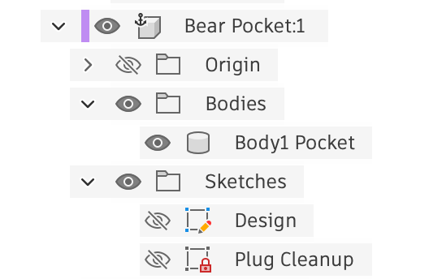    
  </Frame>

  <Frame caption="Pocket Component">
      
  </Frame>

</Columns>

A copy of the target body is created with the Inlay Component cut into it to the inlay depth. 

Two sketches are also created:

1. **Design** - A copy of the design profiles. This is used to limit the machining area. You should not modify this sketch.
2. **Plug Cleanup** - An outline around the design that can be used for "cleaning up" the plug after it is glued in. You can edit and customize this.

<Note>
  If you did not check "New Component" then the selected target body will be directly modified, and the sketches will be added to it's component.
</Note>

## Name Inlay

The actual finished inlay. This is mainly for a visual representation of the inlay and internal computations, and isn't used for machining. Note that it may have many individual bodies.

<Columns cols={2}>
  <Frame caption="Inlay Component in the Browser">
    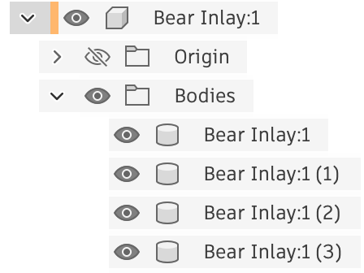    
  </Frame>

  <Frame caption="Inlay Component">
      
  </Frame>

</Columns>

## Name Plug

The plug that fits into the inlay. This is the most customizable part!

<Columns cols={2}>
  <Frame caption="Plug Component in the Browser">
    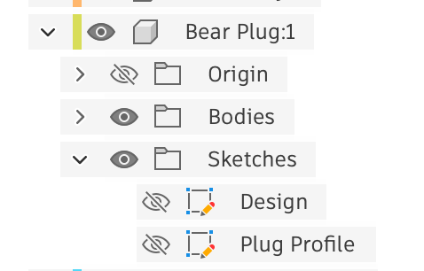    
  </Frame>

  <Frame caption="Plug Component">
      
  </Frame>

</Columns>

Two sketches are also created:

1. **Design** - A copy of the design profiles. This is used to limit the machining area. But you can freely modify where you want each profile to be. You may want to seperate out profiles to give them more space on the entire plug, or to make it so you can cut out each one individually.

2. **Plug Profile** - The main profile around the plug; the plug does not have to be square, and you can create round shapes around your design. Feel free to modify this profile; however, removing profiles will potentially lose the connection in the timeline for the plug's base extrude, and will have to be fixed up (NOTE: I hope to address this in the future!).

### Plug Customization Example 1
In following plug, Fillet was used to round over the corners of the plug body:
  <Frame caption="Rounded Plug Body">
    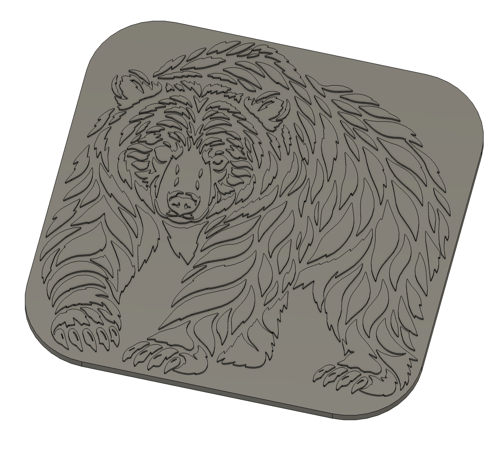    
  </Frame>

### Plug Customization Example 2

<Steps>
 <Step title="Editing the Plug Profile sketch">
  In the following plug, the **Plug Profile** sketch is being edited. The **Design** sketch was made visible. The original rectangle was deleted, and a new "Fit Point Spline" was drawn around the design.
    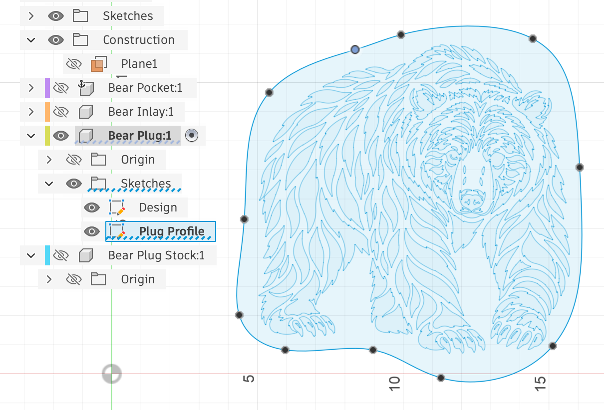    
 </Step>

 <Step title="Timeline Warning">
  <Columns cols={2}>
    <Frame>
The timeline will now have a warning, as the original profile for the extrude was deleted. Right click on it and select "Edit Feature" (as shown) or double click on the timeline item.
  
  </Frame>

  <Frame>
    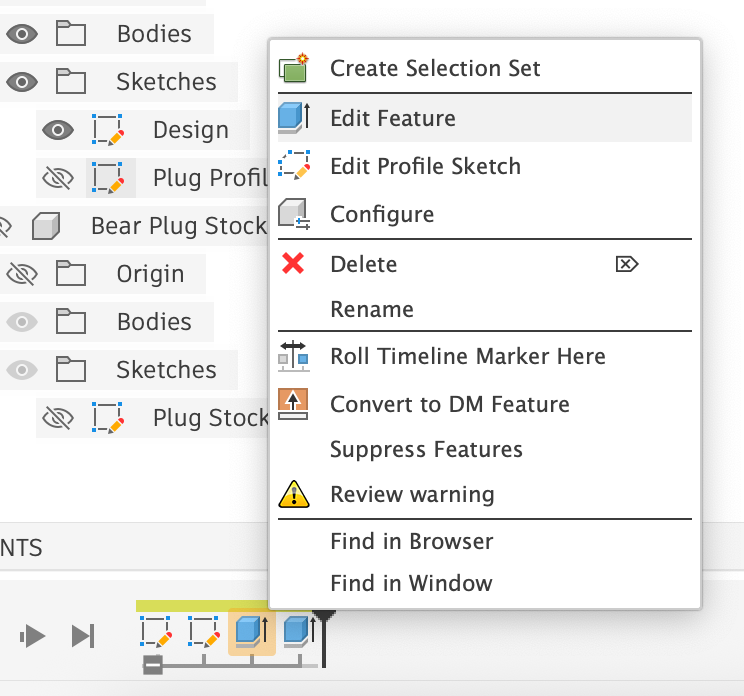    
  </Frame>

  </Columns>
</Step>

 <Step title="Profile Updated">
  <Columns cols={2}>
    <Frame>
The new plug profile can then be selected for the extrude and OK can be clicked to regenerate the Plug.
  </Frame>

  <Frame>
    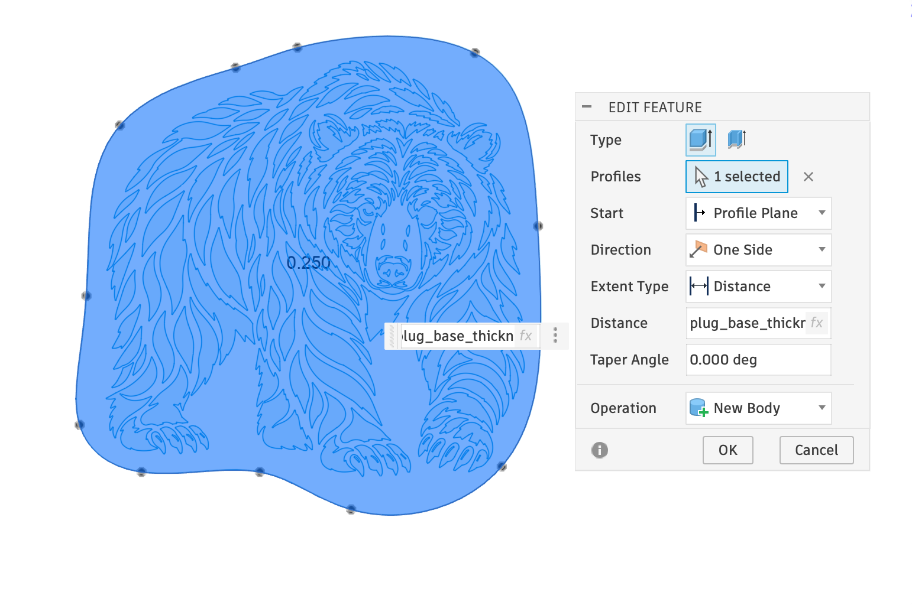    
  </Frame>

  </Columns>
</Step>

 <Step title="Updated Plug">
 The updated plug will now have a more organic profile, which will be easier to glue in:
    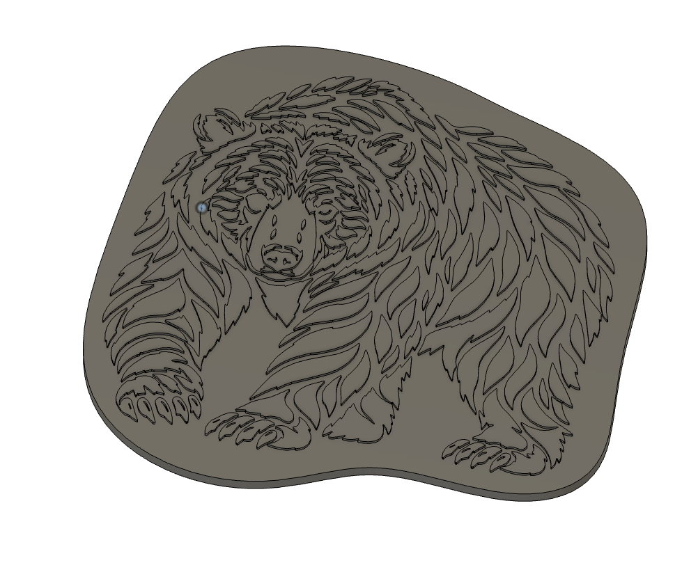    

  <Note>
    I hope to add an "organic" option to plug profiles to make this automatic!
  </Note>
  </Step>

</Steps>
 

## Name Plug Stock

The “Stock Body” for the Plug when machining. It is shown with an opacity of 40% to not be in the way of things. This is another highly customizable component.

<Columns cols={2}>
  <Frame caption="Plug Stock Component in the Browser">
    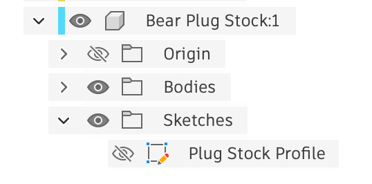    
  </Frame>

  <Frame caption="Plug Stock Component (Translucent rectangle) AND the Customized Plug">
  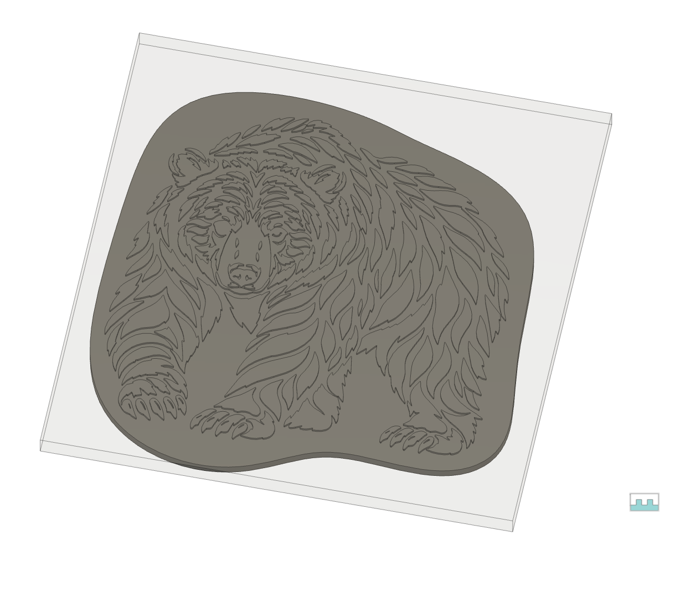    
  </Frame>

</Columns>

This is a specific height above the plug to allow it to go “deeper” into the inlay. The height above the plug is controlled by the `inlay_fit_adjustment` parameter and the `inlay_depth`.

The depth of the plug stock is based on the Plug Base Thickness (Parameter: `plug_base_thickness`), and Inlay Depth. Usually you will first flatten the plug to the required height as descibed later.

There is one sketch created: the **Plug Stock Profile** which you will likely want to edit.

### Editing the Plug Stock Profile

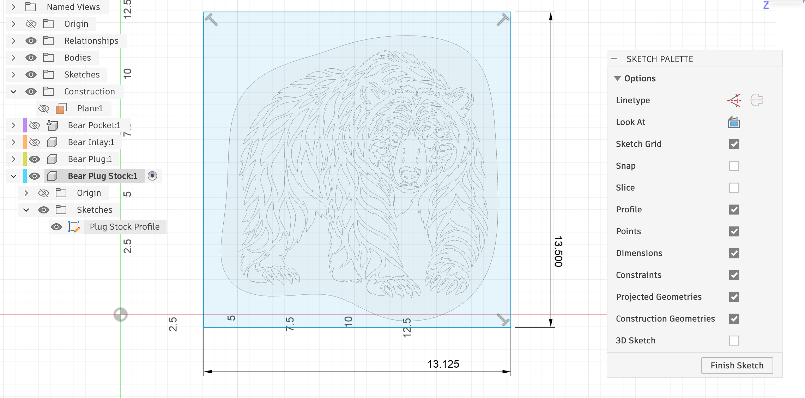   

Your plug stock will generally be rectangular, so constraints are added to maintain a rectangle. You will likely want to resize the rectangle to fit around your plug, and add constraints based on the physical size of your plug stock. In the example above, the plug stock is expected to be 13-1/8" x 13-1/2". 

<Footer />