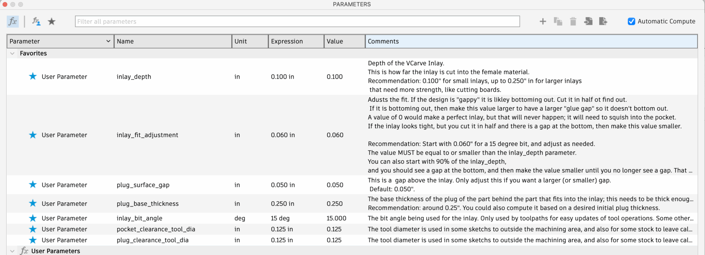
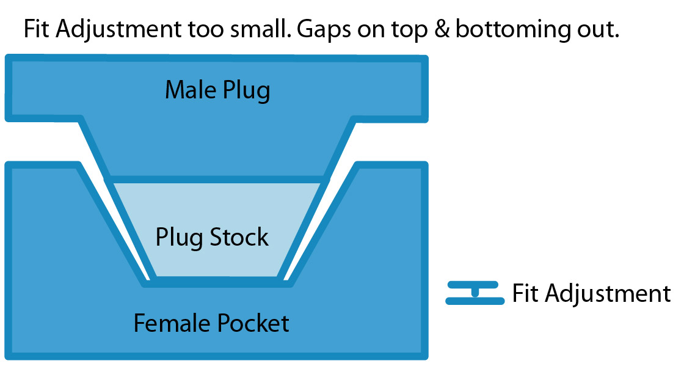
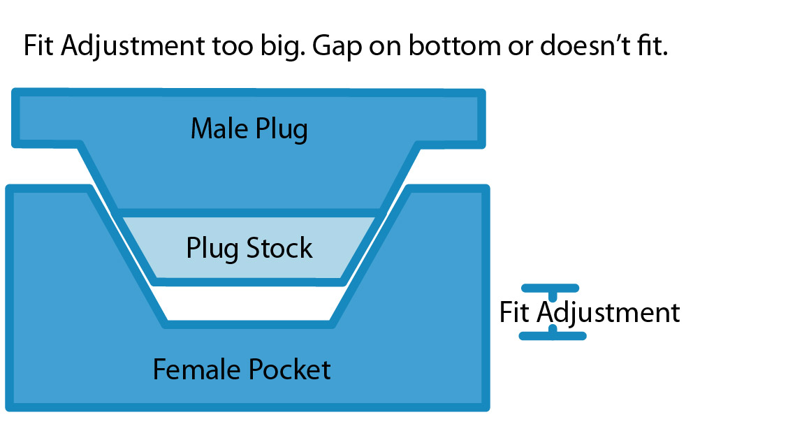

import Footer from "/shared/footer.mdx"

The fit of the inlay is controlled by the `inlay_fit_adjustment` [parameter](/parameters). 

In the Design Workspace, Solid Tab, click **Modify -> Change Parameters** to bring up the dialog:

<Frame caption="Change Parameters Window">
  
</Frame>

Changing any parameter will dynamically update everything: all the the [design model components](/design-components) will change. All the [toolpaths](/pocket-setup-2d#toolpaths) will become invalidated due to expressions based on parameters changing. The Manufacturing Setups will not change.

`inlay_fit_adjustment` can be from 0 to `inlay_depth`. A value of 0 is a “perfect” inlay, where your inlay plug would be exactly the depth of your inlay pocket. However, that usually gives a gap on the top due to the plug bottoming out.

See [VBit Inlay Parameter List](/known_parameter_list) for some known values to start with, and see the [Video References](/video_references) for how to find a good fit.

## How to find a good fit

Finding a good fit involves testing. Start with a value of 0, or something really small like 0.010", and see how your inlay looks. Then change the `inlay_fit_adjustment` based on the problem you are trying to solve.

Using a press is important for larger inlays, as it will **squish** the wood down, compressing some fibers and creating a tight inlay with invisible glue lines.

## Typical Issues and How to Fix Them

### Gaps on the top

If you create an inlay, and it has visible gaps on the top, adjust the `inlay_fit_adjustment` to be **larger** (probably by 0.010″ increments) and try again. 

The issue is the inlay is bottoming out, preventing it from closing the gaps on the top.

<Frame caption="Side View">
    
</Frame>

Making the Fit Adjustment larger will give a larger "glue gap" on the bottom.

### Inlay doesn't fit at all

If the inlay doesn't fit at all, adjust the `inlay_fit_adjustment` to be **smaller**, probably by 0.010" increments.

The issue is the inlay is not “steep” enough, and needs to have a deeper plug part.

### Inlay looks good, but may be hollow

If you create an inlay it may look good with no gaps on the top.

However, cut it in half, and make sure it doesn’t have gaps underneath the inlay. If it does, adjust the `inlay_fit_adjustment` to be **smaller** until it no longer has a gap at the bottom. 

<Frame caption="Side View">
    
</Frame>

The issue is the inlay is not “steep” enough, and needs to have a deeper plug part.

<Note>
Some people prefer having a small "glue gap", but I feel like a zero glue gap is best for strength. 

An inlay with multiple layers, where you machine away the first inlay to insert a second, will require you to have a zero-glue gap. Otherwise, the "island" pieces would simply fall out.
</Note>

### The Inlay Fit Adjustment seems HUGE

If you find you have to have a really large fit adjustment (ie: nearly the value of the inlay), then the problem is likely your bit geometry is not setup right. See [VBit Selection](/vbit_selection) for more information.

### A negative Inlay Fit Adjustment

I think this will work, but you will likely have to make the `plug_surface_gap` larger.

### 3D Inlays - Steep/Shallow

Note some issues and solutions documented in [3D Inlays / Extreme Angles / Machinability](/machinability_3d)

### Other issues

If you see gaps on the top of the inlay and underneath the inlay when you cut it in half, then you likely have an issue with your machine or the design itself:

* **Design issues**: The design may have parts that are chipping off during machining and the design has to be adjusted a bit to avoid this. Read [Vector Design](/vector_design) for how to solve these problems.

* **Machine Squareness**: Ensure you can cut a 5″x5″ square and that it actually measured 5″x5″ with calipers.
* **Machine Tram**: Ensure that your [machine is trammed correctly](https://www.corbinstreehouse.com/blog/2023/04/how-to-tram-a-cnc-spindle-router/).
* **Feeds and Speeds**: Incorrect feeds and speeds can cause jerkiness in CNC movement that will break off bits of the inlay. Dialing in your feeds and speeds is the only way to fix this.
* **Machine Acceleration**: Turning down your machine’s acceleration settings can greatly improve inlays.
* **Clamping/press**: Proper clamping with a press is generally required to get a really uniform inlay. I have only done small inlays, and use clamps. Eventually I’ll do some larger ones and discuss ways to make a press.

<Note>If you find a good value that works for a particular bit, inlay, and wood species, let me know! </Note>

<Footer />