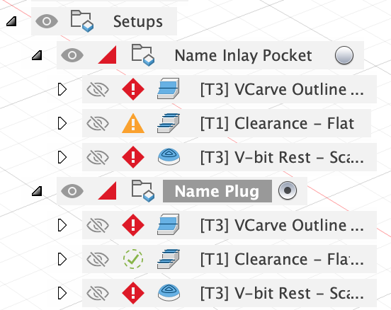
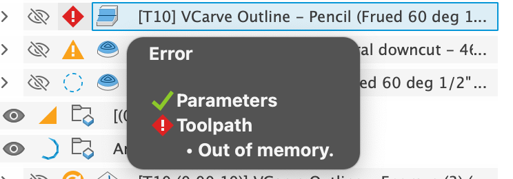
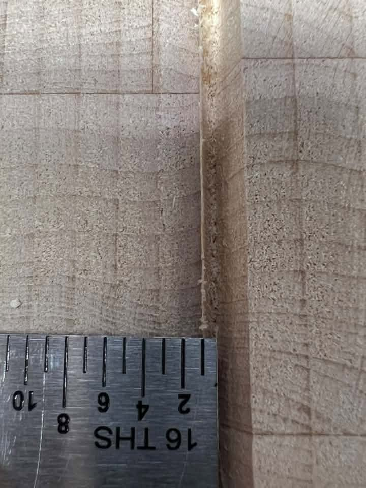
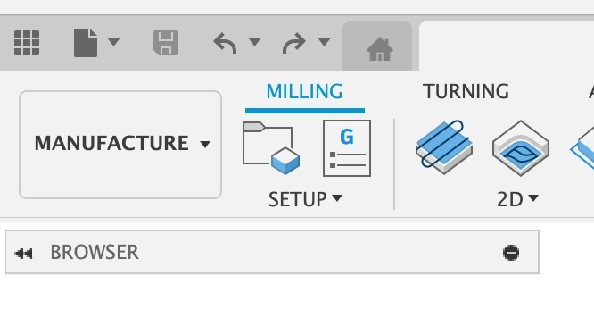
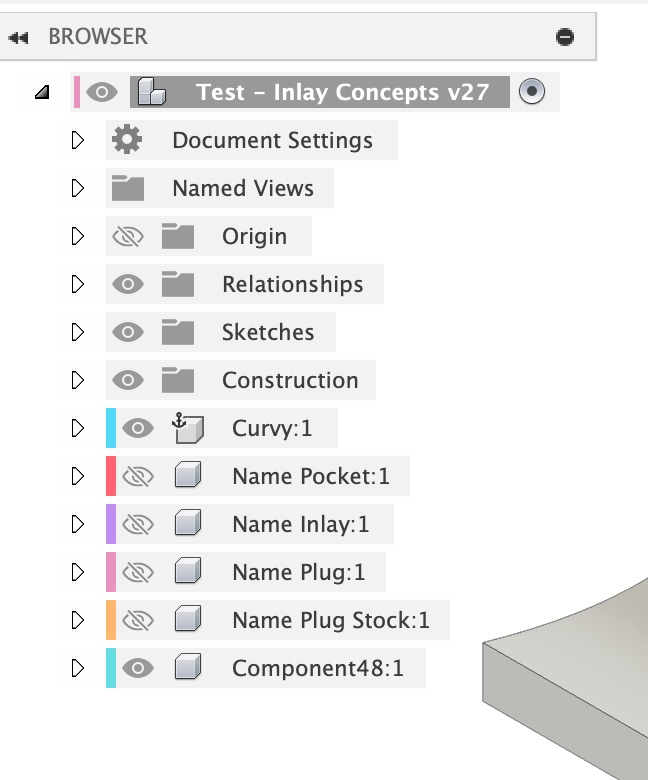

import Footer from "/shared/footer.mdx";

##  Fusion “Spins Forever” After Hitting OK

Ensure your design isn’t too complex. Specifically, if the vector design has a lot short lines made up of a lot of vector points, it will be extremely slow to compute the extrusions. You can test your design by selecting the profiles and doing a normal Extrude. If the Extrude spins forever, then the plugin will hit this same limitation and spin forever.

Unfortunately, the only way to recover from this is to kill, terminate, or Force Quit the Fusion process and start again.

<Note>
    I'm working on some features that will simplify vector toolpaths to avoid this issue!
</Note>

## Toolpath: “Failed to Generate Pass” or “Out of Memory” or “Spins Forever“

If the Pencil and 2D Pocket operations will fail to generate a pass if you are using a pure v-bit **with no tip diameter**. Try setting a small tip diameter, as discussed in [v-bit selection](/vbit_selection).

A “Tapered Ball Nose” (TBN) bit will not work with the 2D Pocket operation unless it is setup as an **Engrave Tool**, also as discussed in the in [v-bit selection](/vbit_selection).

<Columns cols={2}>

  <Frame>
      
  </Frame>

  <Frame>
      
  </Frame>

</Columns>

## 2D Inlay: Clearance toolpath leaving extra stock or ridge

You may see clearance toolpath leaving a small ridge next to the v-carve toolpath and not cutting enough material. This is controlled by the radial “Stock to Leave” setup in the toolpath, and too much stock is set to leave; it is all controlled by parameters and math, so something is off.

<Frame caption="Small Ridge Left (photo from a user)">
  
</Frame>

**Possible cause:** The `inlay_bit_angle` Parameter may not quite match the actual bit angle parameter. Make sure it is accurate!

**Possible cause:** Your bit’s setup tip diameter doesn’t match the actual bit tip diameter (note the hack work around of using a small tip diameter of 0.001" for pure v-bits shouldn’t drastically affect this). **Or, the tip may have broken off**

**Possible cause:** Machine tolerances being too large; make sure your machine has little backlash (tight belts).

If the above things don’t fix it, you can start modifying the parameters that control the “stock to leave” for the pocket toolpath. Modify the `plug_stock_to_leave` or the `pocket_stock_to_leave` Parameters (depending on which one you are having an issue with), and make the value smaller to have it remove more material:

<Frame>
  
</Frame>

Sometimes, with some bits, I was seeing this frequently happen with the plug, so I did add another parameter to address it directly for the plug to remove a little more material, controlled by the `plug_fuzzy_cleanup` parameter; make the value larger to remove more material:

<Frame>
  
</Frame>

## Toolpath “gouge errors”

First, try unchecking ‘Copy Profiles’. This attempts to use a projection of the inlay shape. Copy Profiles will copy the profiles as the machining limits, however, some designs aren’t suited for the toolpath, specifically: 

1. Overlapping lines/profiles, 
2. Intersecting lines/profiles, 
3. Open profiles. 

Generally the only solution is to clean up your vector files to ensure you don’t have anything overlapping or open.

## Selecting a Sketch will sometimes “miss” closed profiles

I think this is fixed; if you see this problem, please send me info!

When I do see the problem, it ends up being overlapping vectors and small profiles.

## RuntimeError: 3 : Projection of the selected spline/curve would result in a degenerate segment and cause future modeling problems!

I think this is a Fusion bug try to check “Copy Profiles” to avoid this. 

**If you still get it, please let me know so I can fix it!**

## Text sometimes doesn’t create the right size inlay

This seems to be a bug in Fusion calculating the text size. In your Sketch, Right click on the text and “Explode Text”. Then try again with the exploded text. This is reported as: https://forums.autodesk.com/t5/fusion-api-and-scripts-forum/sketchtext-boundingbox/td-p/13635972

## 2 : InternalValidationError : face

This seems to be a bug in Fusion 360 caused by SketchText objects. In your Sketch, Right Click on the text and “Explode Text”. Then try again with the exploded text.

## Jerkiness in CNC Machine Movement

Possibly too dense of a Gcode file. Increasing the Smoothing value may help to reduce the size of your GCode file.

## Updating Text After Generation
You can select text profiles in a Sketch, but editing it after the inlay was generated will likely not work. There is no way for me to keep track of the bodies changing. You could manually fix it up, but it is probably easier to just run the plugin again when you change the text.

## Bug: Parameters not working in any of the toolpaths

Two users have reported that the parameters are not working in the CAM/Manufacturing portion of Fusion. This seems to be a bug in Fusion, and has been reported via the Forums and directly to the the developers via email (https://forums.autodesk.com/t5/fusion-api-and-scripts-forum/parameters-not-showing-up-in-cam-manufacturing-workspace-for/m-p/14131644#M22795). I’m sure it is something I’m doing in the plug-in with how Setups are created, but I can’t narrow down what causes it, as I can’t make it happen. Autodesk can see the problem after it occurs (as can I), but neither of us can reproduce it on our systems.

## Empty CAM Browser

Sometimes the CAM/Manufacturing workspace browser shows up empty, as shown to the right. Clicking the Show/Hide icon doesn’t help. You have to close the project and reopen it to get it to show up. I think Fusion has fixed this bug, as I haven't seen it happen recently.

<Columns cols={2}>

  <Frame caption="Empty CAM Browser">
      
  </Frame>

  <Frame caption="Normal CAM Browser">
      
  </Frame>

</Columns>

<Footer />