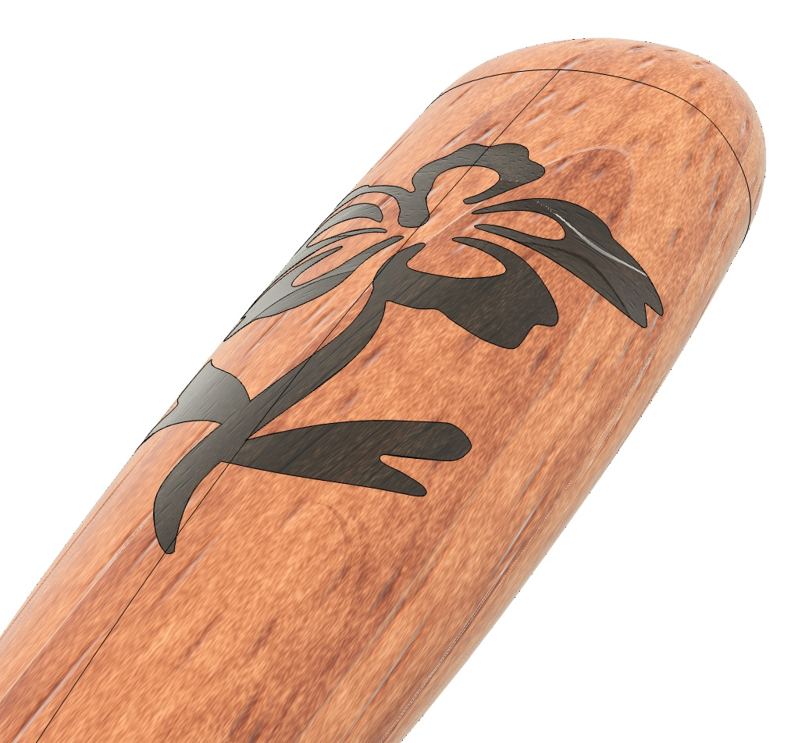
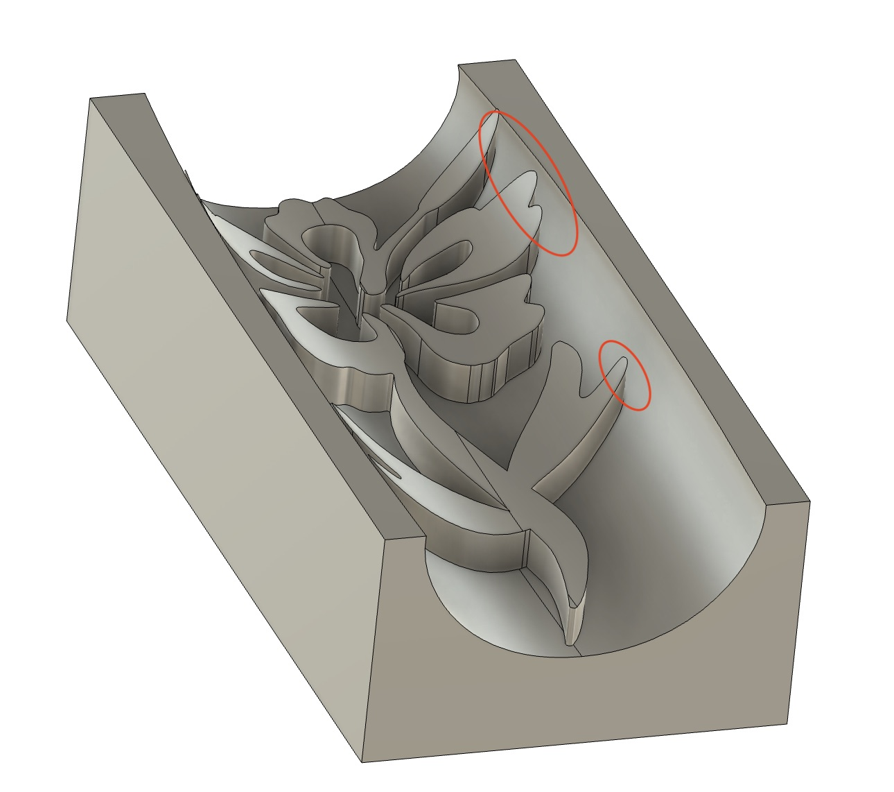
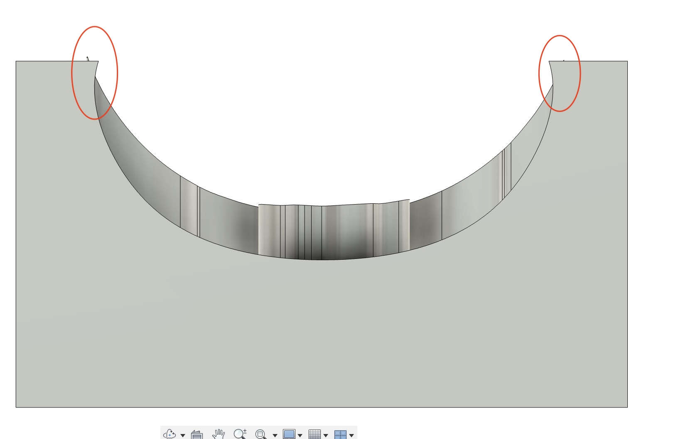
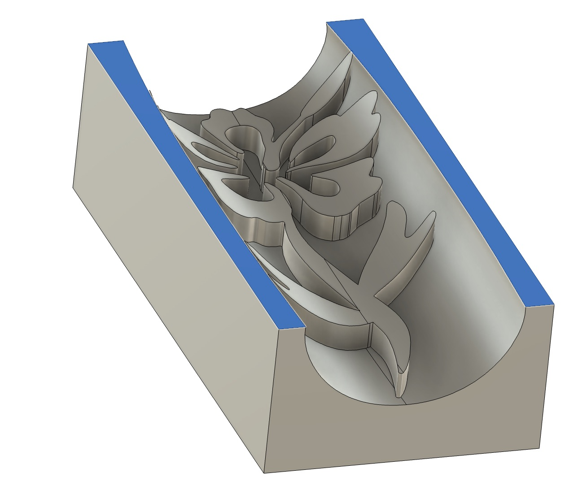
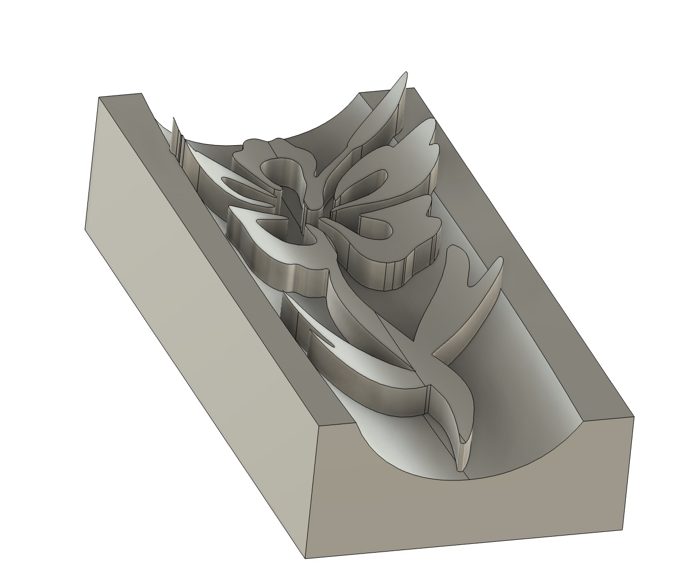

import Footer from "/shared/footer.mdx";

## Extreme Angles

<Frame caption="Steep Edge">
  
</Frame>

Note some potential issues when you create a plug that approaches the vertical edge of a piece, as shown above. The curved inlay (Hibiscus Flower) on this handle is very close to the edge of the handle, and the handle isn’t very thick.

The resulting plug is shown below. It has two problems for machinability: the edges are past vertical and overhanging, which is impossible for a bit to machine. The curved edges are also too close to the edge of the inlay plug; another thing that a bit can’t get into.

<Columns cols={2}>

  <Frame caption="The plug that was created, with problem areas highlighted">
      
  </Frame>

  <Frame caption="Areas that require undercutting">
      
  </Frame>

</Columns>

Machining this shape will result in a plug that won't fully seat, and it will be gappy. (I know, because I accidentally did this!). 

The easy fix: select the top planar edges (shown in blue) and do a ""Move", and move them down until they no longer would cause a problem.

<Columns cols={2}>

  <Frame caption="The edges are first selected, then moved down a bit.">
      
  </Frame>

  <Frame caption="The modified plug">
      
  </Frame>

</Columns>

This creates a much more machiable plug.

<Footer />