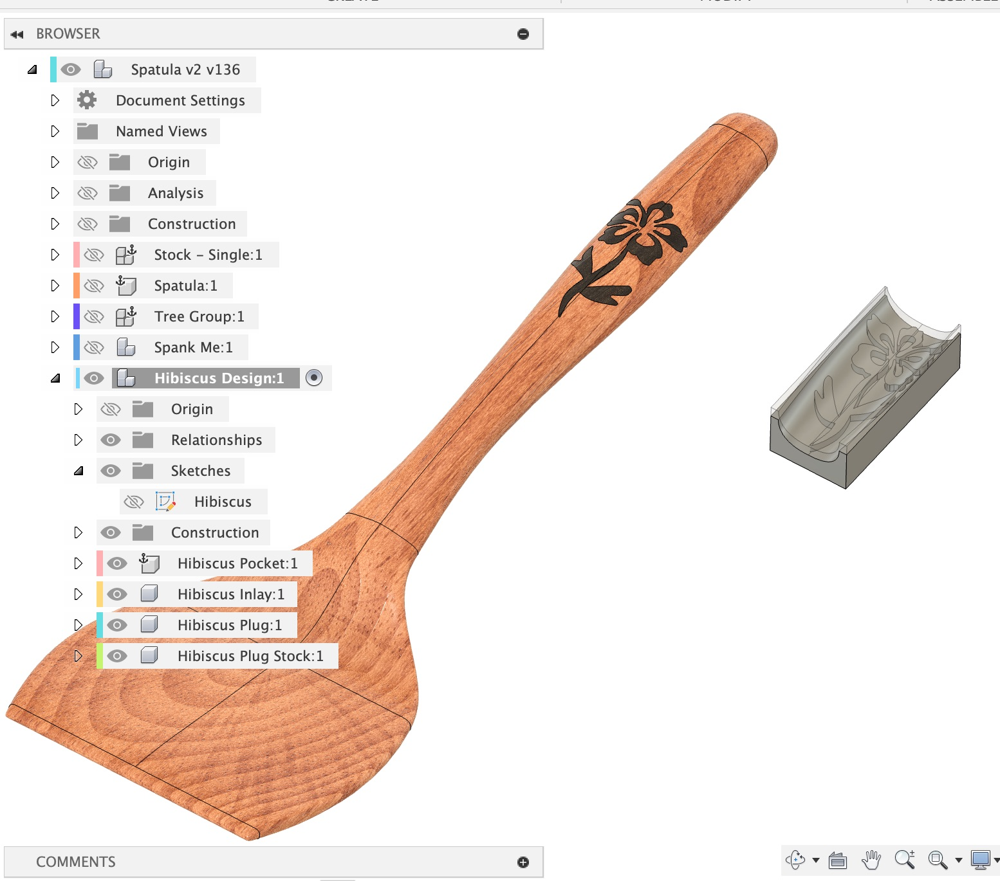

import Footer from "/shared/footer.mdx";

The current *active component* will become the parent for all the [sub-components the plugin creates](/design-components) (Pocket, Inlay, Plug and Plug Stock). In general, before I run the plugin I will create a new empty component to contain all the relative sub-components, as they are all related. I also find this a good place to put my design sketch. This is good for a **one-to-many** relationship: you have one primary CAD shape, and you want to have a lot of different variations of inlays you can do on the main shape.

The example below illustrates this. I like to have a lot of different inlay designs for my spatula. I created a new empty component named “Hibiscus Design” and activated it. I created a Sketch in that component for my design. I then ran the plugin while the Hibiscus Design component as active, and it generated all the related components in one group. This makes it easy to hide or show the entire group.

<Frame caption="Component Organization">
  
</Frame>

## When to NOT use "New Component"

In general, if you want to have a bunch of inlays targeting one particular body, I recommend unchecking **New Component**. This is generally only useful for flat 2D inlays. For 3D shaped inlays, you will likely need to machine your basic shape before actually machining the inlay pocket, so you need a copy of the basic shape without the inlay pocket to get it done correctly.

<Footer />