import Footer from "/shared/footer.mdx";

## Setup

The plugin will (optionally) generate a plug setup and toolpaths.  The Setup for the Inlay Plug is similar to the [Inlay Pocket Setup](/pocket-setup-2d), but the Stock different. The Stock Solid is set to the [Plug Stock](/design-components#name-plug-stock) that was created by the plugin.

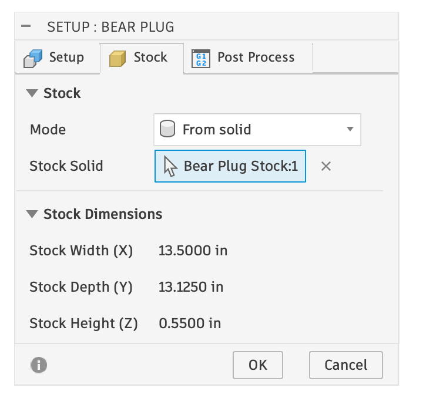    

<Tip>
    Look at the *Stock Dimensions* to determine how big of a plug stock you need, and make the thickness (Z-Height) slightly thicker. The above shows 0.550" thickness; I start with very rough 5/8" thickness (0.625"). The first toolpath operation will be a clearance operation that gives you the perfect flat 0.550" thickness!
</Tip>

## The Extra Plug Stock

This is the main trick for a plug to seat deeper in the inlay. The stock is intentionally higher than the model; specifically, it is higher by the `inlay_depth - inlay_fit_adjustment`. This can be seen in the images below from the side; the one on the left shows the stock (in translucent yellow) above the design (in gray). The image on the right is the simulation after the last toolpath runs, showing the v-carved edges and the inlay going “deeper” (higher) due to the extra stock.

<Columns cols={2}>

  <Frame caption="Side View: The designed plug (gray) and the stock (yellow)">
  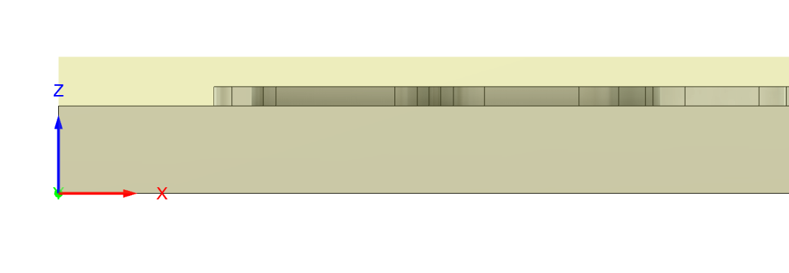    
  </Frame>

  <Frame caption="Side View: the plug (green) after running a simluation, showing greater depth on top due to extra plug stock.">
  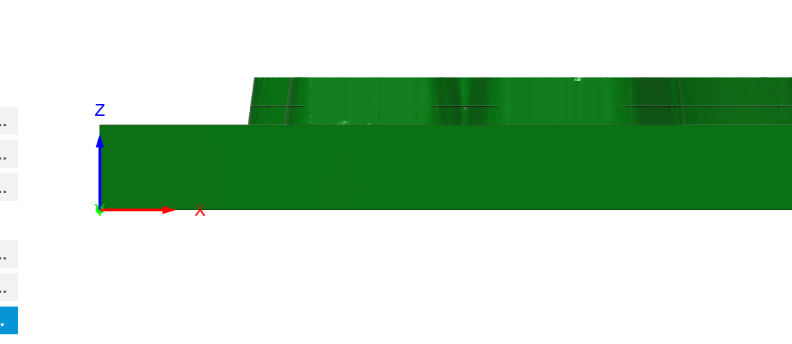    
  </Frame>

</Columns>

## Toolpaths

The plug has the following toolpaths automatically generated (assuming all options checked and two clearance bits):

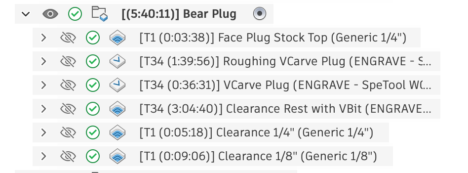    

The toolpaths are setup similarly to how the pocket toolpaths are setup, but differences are noted below:

### 1. Face Plug Stock Top

The largest clearance bit will be used to face the plug **to the stock top**. This assumes your stock is slightly larger than what you tell Fusion, and this first toolpath ensures it is prefect dead on flat.

Note that in the Heights tab it is set to go from above the Stock top to a "Bottom Height" of the "Stock top":
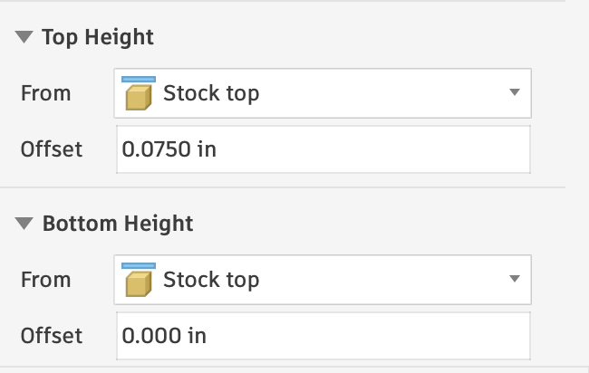    

<Danger>
    Do not machine to Model Top! The extra stock is very imporant.
</Danger>

### 2. Roughing VCarve Plug

This uses the V-Bit to do a roughing engrave pass, which may be required becase we are essentially tricking Fusion by having larger stock than what the model shows, and want that to be part of what we create.

On the Geometry tab, the Sketch Profile is set to **two entities**. First it is set to the Silhouette of the Plug, starting on the inside. Second, it is set to a sketch: the **Design** sketch that was created in the ["Name Plug"](/design-components#name-plug) based on the selected vector design. It is also set with a Side of “Start Outside", which is important! Double click on the list item to see these details:
<Columns cols={2}>

  <Frame caption="On the Geometry tab: Silhouette and Sketch.">
  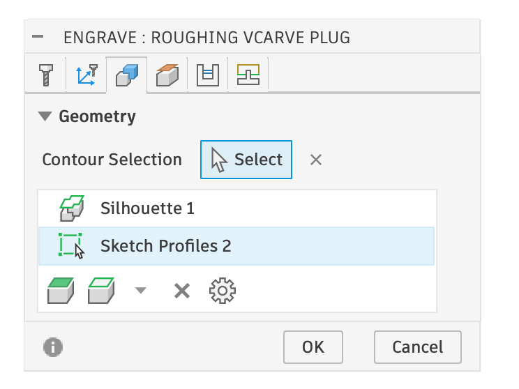    
  </Frame>

  <Frame caption="Showing the selected Sketch for the Plug Design, Starting Outside of the sketch profiles.">
  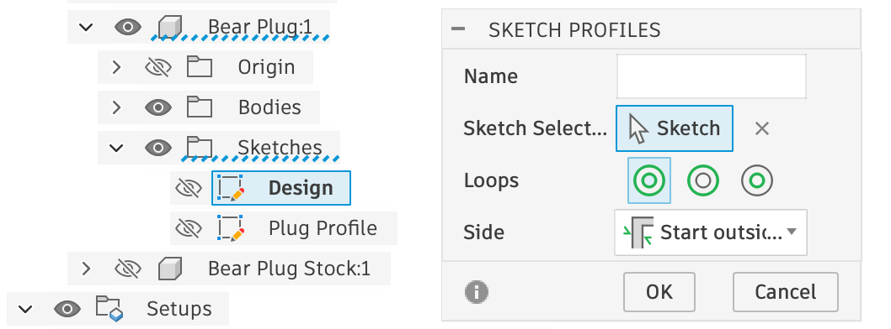    
  </Frame>

</Columns>

The special settings for the Roughing Pass is for it to start at the Stock Top, and go down to the Model Top. You can control how deep each step is with the optional multiple depths.

<Columns cols={2}>

  <Frame caption="Heights Tab: Stock top down to Model Top">
  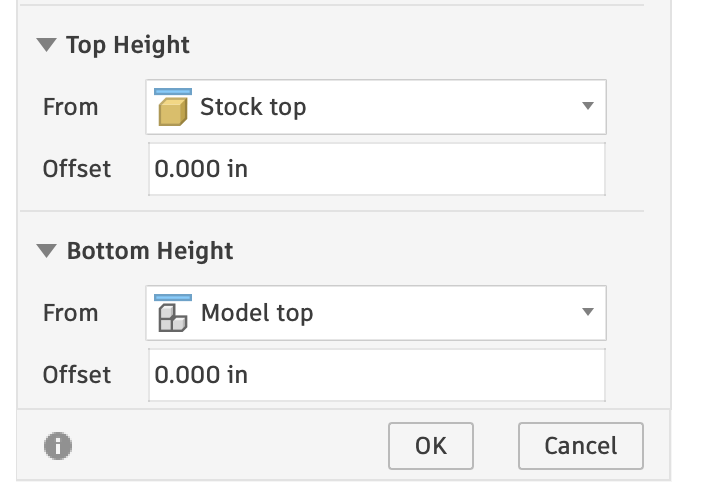    
  </Frame>

  <Frame caption="Passes Tab: Optional Multiple Depths ">
  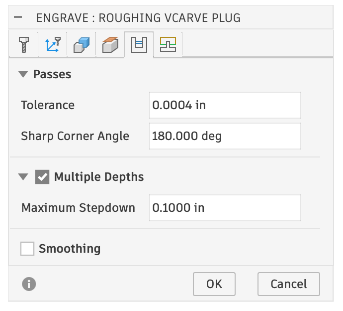    
  </Frame>

</Columns>

<Note>
    Depending on the plug depth, and your CNC machine, you may be able to delete the roughing pass entirely!
</Note>

### 3. VCarve Plug

This toolpath is setup identically to the last one, except the Heights tab is different:

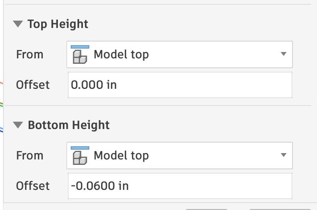    

The Top Height (ie: Starting Depth) is the Model Top, and the Bottom Height (ie: Final Depth) is a specific value, -.060" in this case. As in other cases, the value is an expression that dynamically updates, and the expression is set to the Parameter `-plug_depth`. `plug_depth` is a math equation set to: `plug_surface_gap + inlay_fit_adjustment`.

### 4. Clearance Toolpaths

The next toolpaths are all clearance toolpaths, with the Geometry setup as described for the other toolpaths here, and the Rest Machining setup as describe for the [Pocket Setup Clearance Bits](/pocket-setup-2d). 

## Plug Cutout

At this point, you can run all the toolpaths and manually cutout the plug, or you can add one more toolpath to cut it out (with or without tabs). I add a 2D contour setup to cutout the Silhouette with an upcut bit:

<Columns cols={2}>

  <Frame caption="Toolpath Setup">
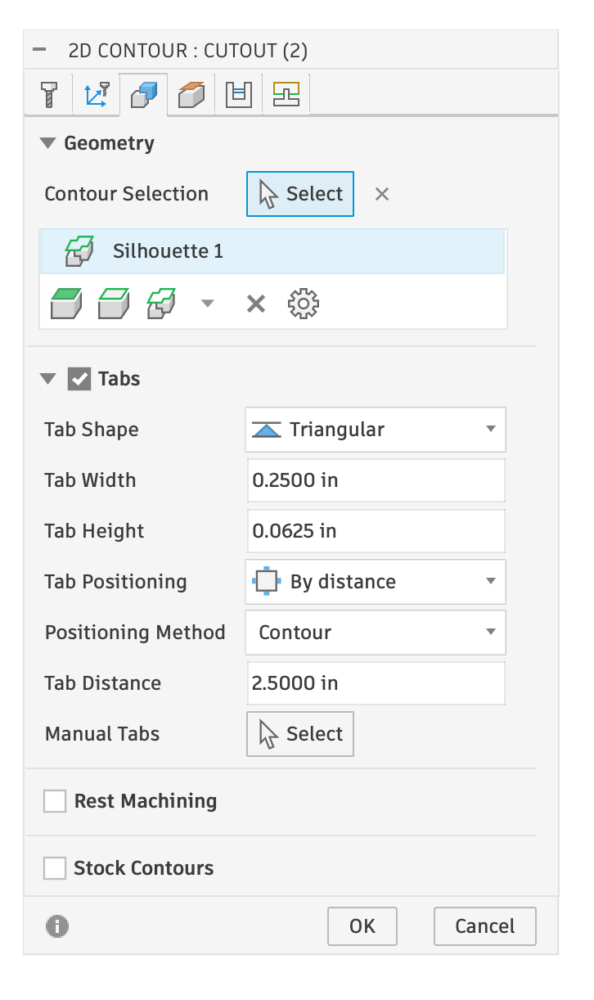     
  </Frame>

  <Frame caption="Result ">
  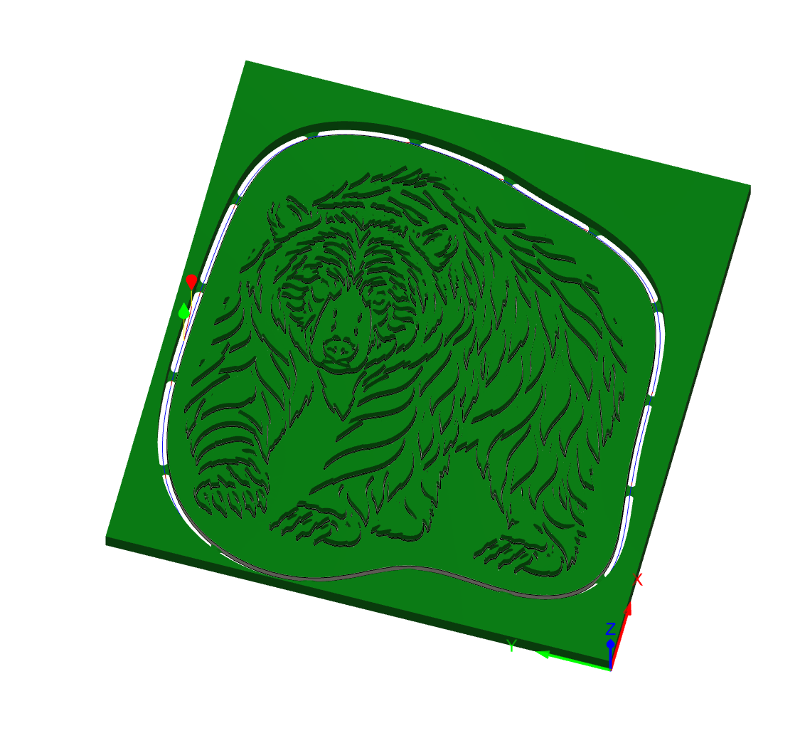    
  </Frame>

</Columns>

<Note>
    I may eventually add an option to automatically generate this toolpath!
</Note>

<Footer />