import Footer from "/shared/footer.mdx";

## Setup

The plugin will (optionally) generate a pocket setup and toolpaths. The Pocket Setup has the following customizations:

1. The WCS Origin is set to “Stock Box Point”, and the Stock Point is pre-selected to be the “Front Bottom Left” corner. This means **the Z-zero is the bottom of the project**, ie: the spoilboard. You can change this if you like.
<Note>
    Optional: If you checked "Swap X/Y Axis", the setup will look like the second picture.
</Note>
2. The Stock is set to “From solid” and the original Target Body is selected. For basic planar “2D” inlays, you can set it to “Relative Size Box” and change it to your liking.

<Columns cols={3}>
  <Frame caption="Setup Tab - Default">
    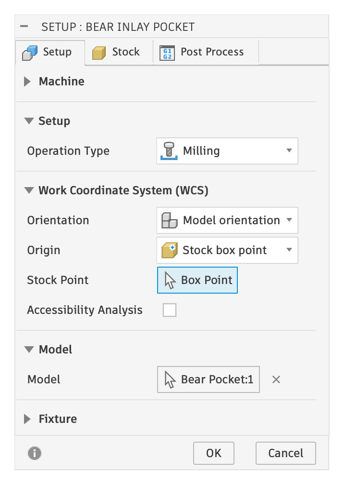    
  </Frame>

  <Frame caption="Setup Tab - Swapped X/Y">
  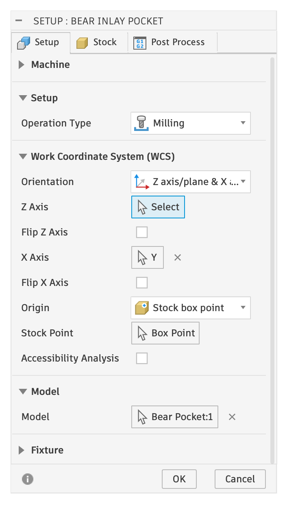    
  </Frame>

  <Frame caption="Stock Tab">
  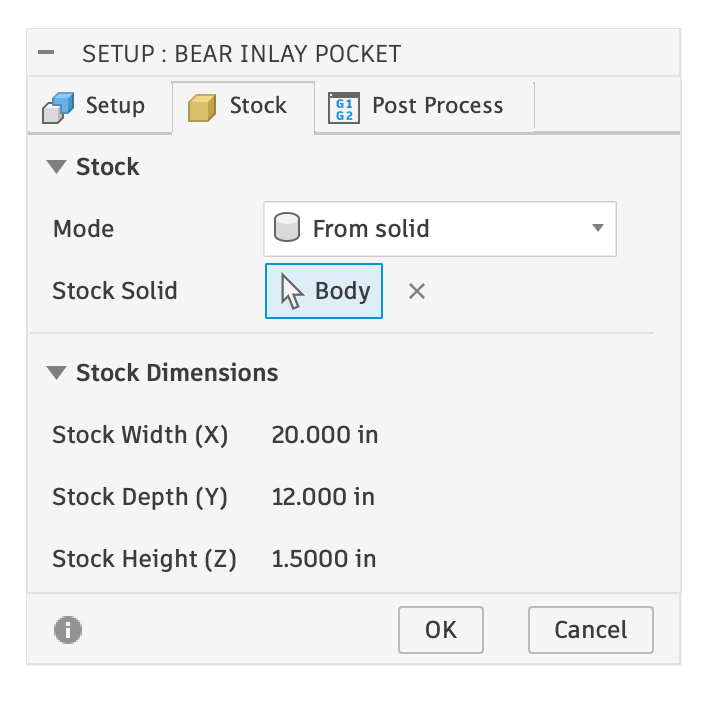    
  </Frame>
</Columns>

<Tip>
    The Stock tab is a great way to figure out what size stock you should be using!
</Tip>

<Tip>
    Sometimes I'll set the stock to "Relative Size Box" and add 0.020" to the height on top. I'll machine the pockets and glue in the inlay plug. Then, I'll surface off the plug at "Stock Top" (which is now 0.020" above the model) to remove the plug. Finally, after all inlays are glued in and surfaced, I'll surface to "Model Top + 0.010" to leave 0.010" on top. Then I'll run it through the drum sander to remove the final 0.010".

</Tip>

## Toolpaths

The pocket has the following toolpaths automatically generated:

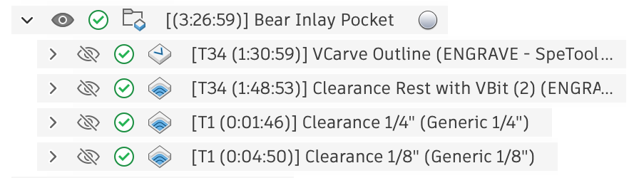    

### 1. VCarve Outline

A [2D Engrave toolpath](https://help.autodesk.com/view/fusion360/ENU/?guid=2D-ENGRAVE-STEPS) in Autodesk Fusion. Engrave will only follow closed profiles. 

The Sketch Profile is set to a single Sketch: the **Design** sketch that was created in the ["Name Pocket"](/design-components#name-pocket) based on the selected vector design. It is also set with a Side of “Start Inside”, which is important! Double click on the list item to see these details:
<Columns cols={2}>

  <Frame caption="On the Geometry tab, the Contour Selection is set to Sketch Profiles.">
  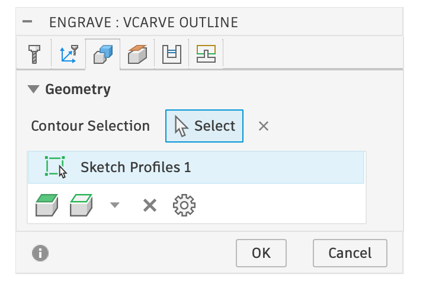    
  </Frame>

  <Frame caption="Showing the selected Sketch in the Browser">
  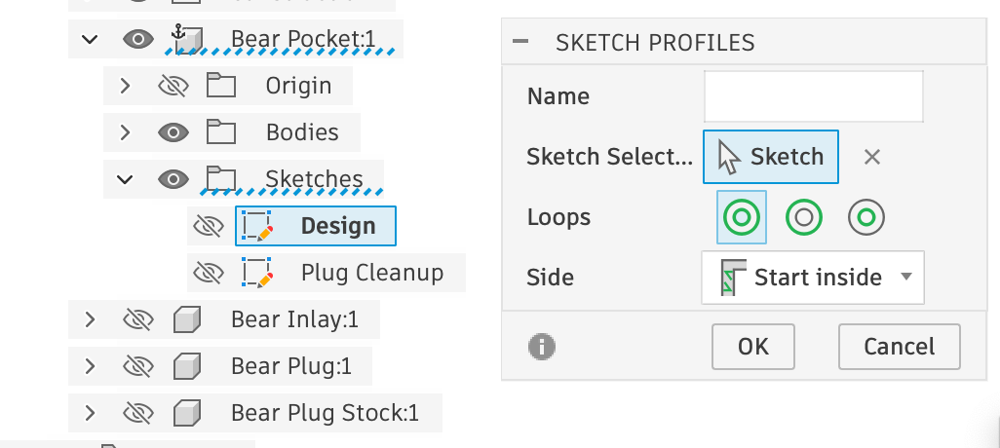    
  </Frame>

</Columns>

<Tip>
    To find what is selected, look in the Browser and look for components with a blue-dashed underline. Expand items until you see the actual selection (ie: the Design sketch in the above right photo)
</Tip>

On the Heights tab, the Top Height determines where the design should be followed (Model top), and the Bottom Height is how deep it should go (the "inlay depth", also known as the "flat depth" in other software). The Bottom Height shows an evaluted number *(**-0.25 in** for this example)* but it is an **expression**. You can click the three dots to the right of the Value Input and select **Edit Expression**. You'll see that the expression is set to `-inlay_depth` a [Parameter](/parameters) which can be customized at anytime.

<Columns cols={2}>

  <Frame caption="Heights Tab">
  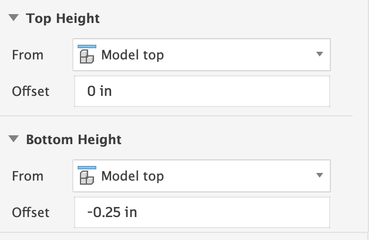    
  </Frame>

  <Frame caption="Bottom Height Expression">
  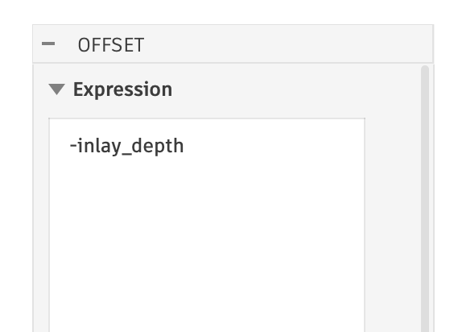    
  </Frame>

</Columns>

The Passes tab has a Multiple Depths option that can be turned on to easily limit the depth of cut with a Maximum Stepdown.

The Sharp Corner Angle is usually 165 degrees, but I set it to 180 degrees to make all corners sharp. You may get good results with it set to 165 degrees, and have a shorter machining time.

  <Frame caption="Passes and Sharp Angle Settings">
  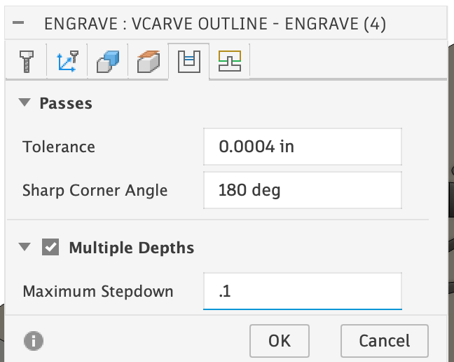    
  </Frame>

### 2. Clearance Rest with VBit

The second toolpath with a vbit is ordered second to minimize tool changes, but it is the toolpath that will cleanup anything that the next clearance bit toolpaths could not get to. Explaining the next toolpaths first makes more sense, and then I'll come back to this one.

### 3. Clearance 1/4" (Largest diameter first)

A basic 2D pocket that that uses the selected flat end mill to do clearance. 

The Sketch Profiles and Heights are set exactly like [1. VCarve Outline](#1-vcarve-outline)

The most important part is the Stock to Leave on the Passes Tab. The “Radial Stock to Leave” is set to what appears to be a specific value (*0.0329131 in*). This is an expression. You can click the **three dots** to the right of the Value Input and select **Edit Expression**.

<Columns cols={2}>

  <Frame caption="Radial Stock to Leave on the Passes Tab">
      
  </Frame>

  <Frame caption="Stock to Leave Radial Expression">
  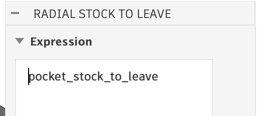    
  </Frame>

</Columns>

The Expression is set to the [Parameter](/parameters) `pocket_stock_to_leave`. If you look at the Parameter, you will see its value is set to: **tan(inlay_bit_angle / 2.0) * inlay_depth** – this is some basic math that keeps the clearance operation away from the edges of the inlay by the exact amount that the v-bit leaves behind. This one of the main tricks for VCarving Pockets with a clearance bit.

<Note>
    Things you can and potentially should change: Multiple Depths, and Ramp
</Note>

### 4. Clearance 1/8" (& smaller diameters)

Subsequent toolpaths are setup exactly like the above toolpath, with one exception: on the Geometry Tab **Rest Machining** is turned on, and the Tool Diameter is set to a specific value *(shown here as 0.2960 in)*.

<Columns cols={2}>

  <Frame caption="Rest Machining turned on with the Tool Diameter set">
  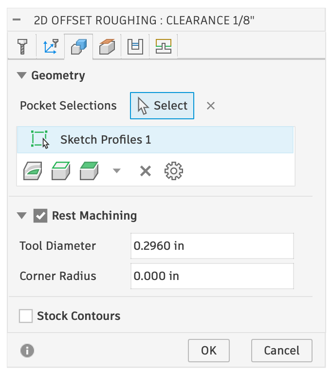    
  </Frame>

  <Frame caption="Tool Diameter Expression">
  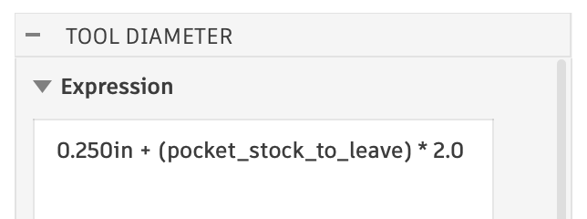    
  </Frame>

</Columns>

The Tool Diameter is set to another expression based on Parameters: `0.250 in + pocket_stock_to_leave * 2.0` — this special value is what makes the 2D Pocket attempt to get the area that the previous larger bit could not fit into.

The expression is **very specific**: it takes the previous bit's diameter, **0.250 in** in this case, and adds in `pocket_stock_to_leave * 2.0` -- the amount that the v-bit needs to leave by the engraving toolpath cut in [1. VCarve Outline](#1-vcarve-outline)

For multiple clearance bits, each bit will have the previously larger bits diameter set in it's expression. 

<Warning>
    You MUST include the units in this value; otherwise they are interpreted as centimeters. For example, write `0.250 in` or `0.250"` or `6mm` -- if you just write a basic number without units it will be assumed to be cm, which is different than how Fusion works in every other locations!
</Warning>

So back to **2. Clearance Rest with VBit** - it it setup in exactly the same way, and it gets all the areas that the previous bit diameters could not reach.

## Toolpath Order

For 2D inlays, the order of the toolpaths is *somewhat* important, as Rest Machining assumes the previous bit cleared that area, and may drag the next toolpath bit across it, potentially causing a collision. This can ben an issue for the  **2. Clearance Rest with VBit**, if you run it first, but practice this isn't too big a deal.

You can also reorder the toolpaths however you want because they are not dependent on any prior information (it is all contained in the toolpath). It might make more sense to do the clearnace operations before the v-bit operations. Some people prefer to do this.

<Footer />