import Footer from "/shared/footer.mdx";
import Pencil from "/snippets/multiple_depths_pencil.mdx";

<Note>
    
The Setups and Toolpaths for 3D inlays are very similar to 2D inlays. I'll only discuss what is different from 2D Inlays, so please read [Pocket Setup - 2D](/pocket-setup-2d) first.
</Note>

## Setup

The main difference between 2D and 3D inlays is the Setup's *Stock Solid* is a 3D object. Consider machining this 3D inlay pocket for a tree on the handle of this spatula (from [Digital Files: Wok Spatula](https://www.corbinsworkshop.com/shop/digital-files-wok-spatula-directions-vectric-vcarve-file-fusion-cad-cam-and-stl-model/))
<Frame>
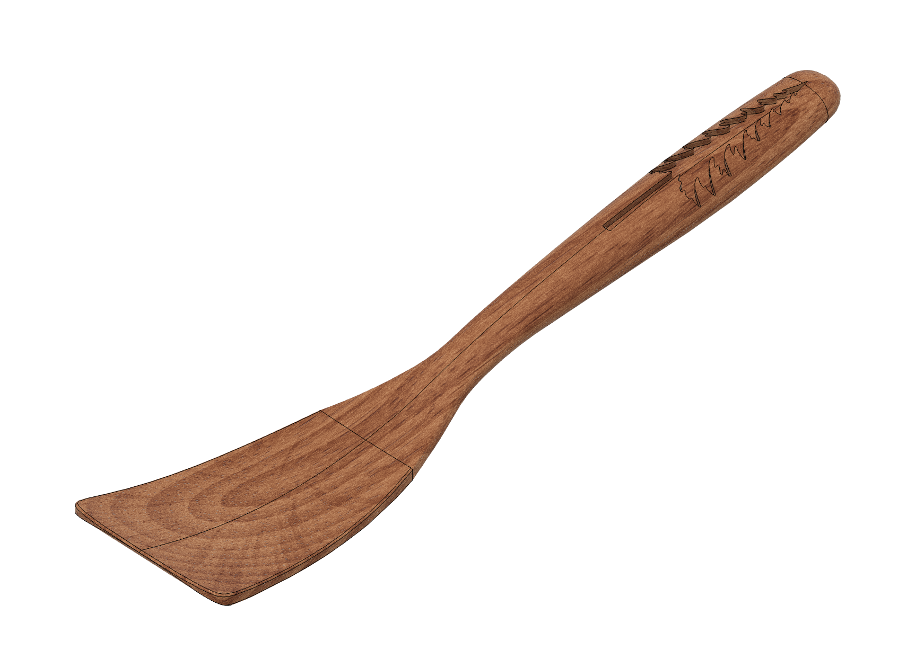    
</Frame>
The Setup's stock is set to the original body before the inlay was created (in a case like this, choosing "Create Component" is essential):

<Columns cols={2}>

  <Frame caption="Setup: Stock mode set to 'From solid'">
  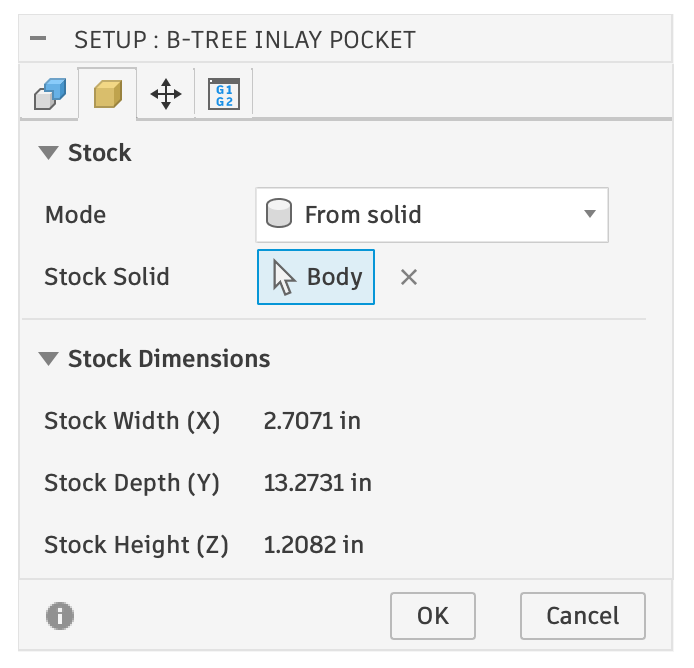    
  </Frame>

  <Frame caption="The solid body that is the stock">
  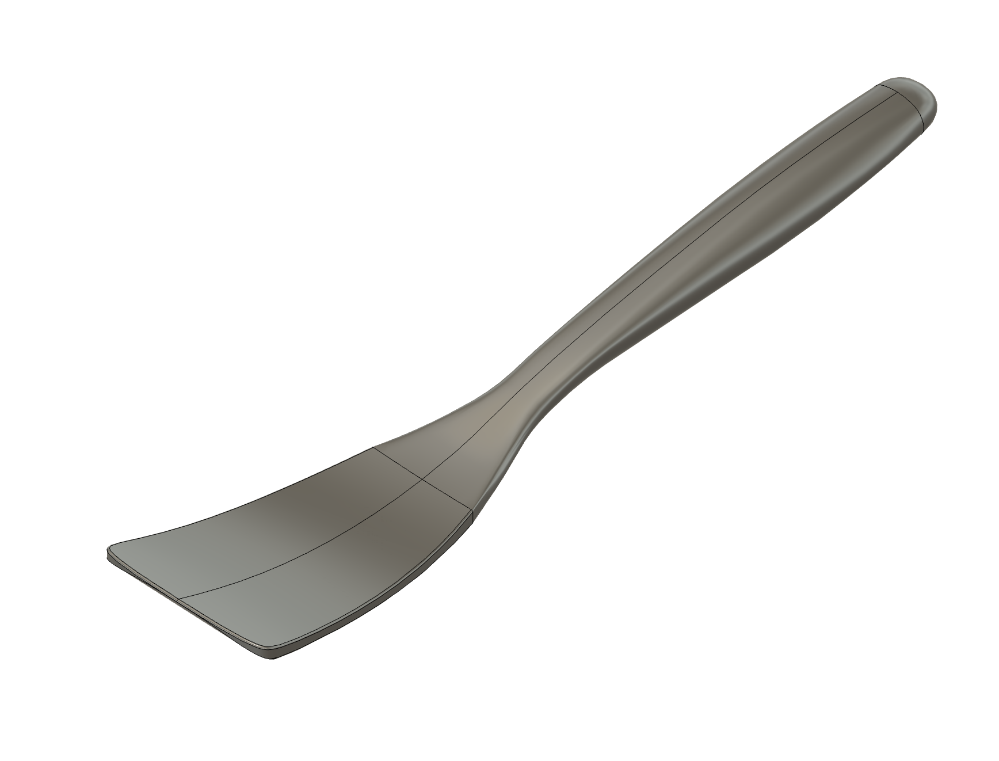    
  </Frame>

</Columns>

This means that you should already have machined the 3D shape before you start to create the inlay. In this example, the spatula top has been machined out before the inlay pocket begins:

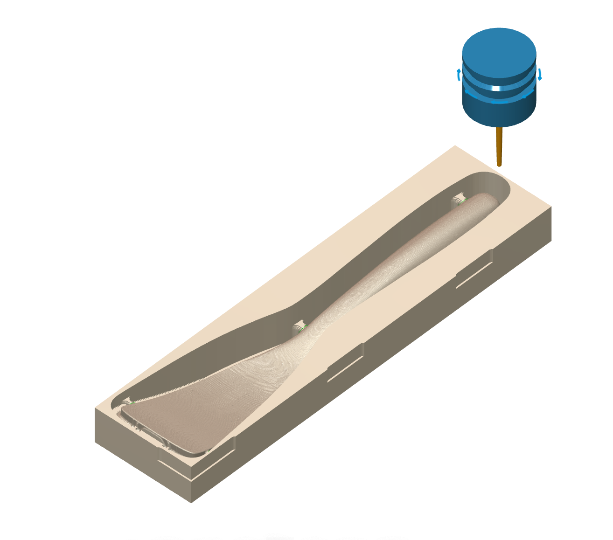    

<Note>
    It is important to use the same origin for your inlay pocket and the machining that got you your initial shape!
</Note>

## Toolpaths

The 3D toolpaths work very differently from the 2D toolpaths, as they have to follow the 3D contours of your target body.

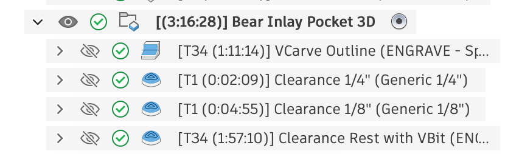  

<Warning>
    The order of 3D toolpaths is important, as they utilize Rest Machining! Reordering them is possible, and is discussed at the end.
</Warning>

### 1. VCarve Outline

This is a [3D Pencil Toolpath](https://help.autodesk.com/view/fusion360/ENU/?guid=3D-PENCIL-STEPS) in Autodesk Fusion using your VBit to do a VCarve. The important part is the Gemoetry Tab. The Machining Boundary Selection is set to a Sketch Profile, and the **Design** Sketch in the Pocket component is selected (this is similar to the 2D Pocket's setup).

<Columns cols={2}>

  <Frame caption="On the Geometry tab, the Machining Boundary Selection is set to Sketch Profiles.">
  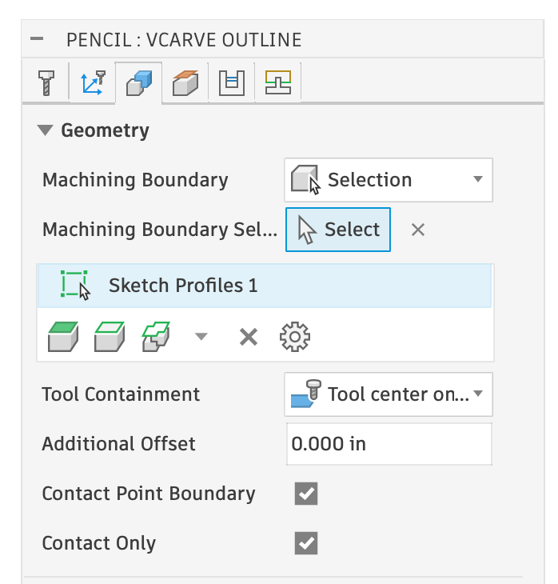    
  </Frame>

  <Frame caption="The Sketch Profiles highlighted (green)">
  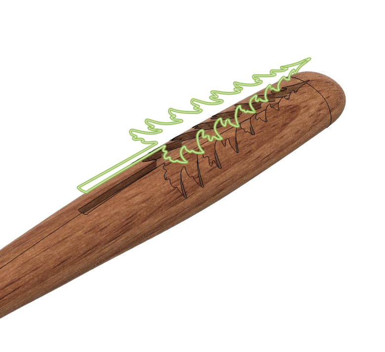    
  </Frame>

 <Frame caption="The Design Sketch is selected">
  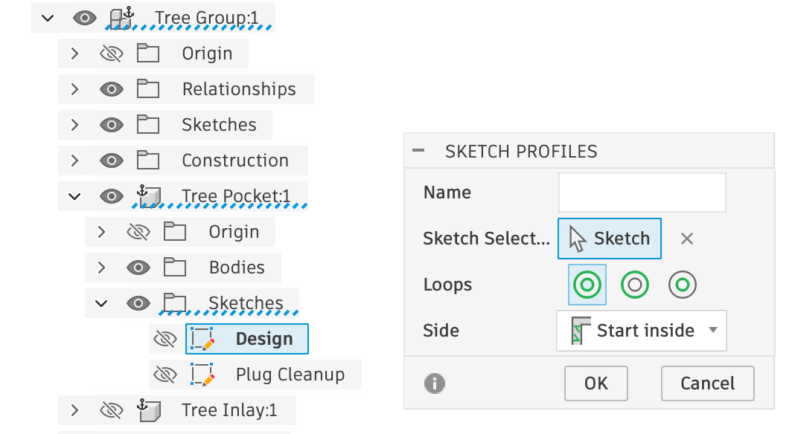    
  </Frame>

</Columns>

<Tip>
    To find what is selected, first click on the Sketch button. Look in the Browser and look for components with a blue-dashed underline. Expand items until you see the actual selection (ie: the Design sketch in the above photo)
</Tip>

**Tool Containment** is set to Center, **Additional Offset** is set to 0, and **Contact Point** options are checked.

### 2. Clearance Toolpath - Largest Bit

The first clearance toolpath is a [3D Scallop Toolpath](https://help.autodesk.com/view/fusion360/ENU/?guid=3D-SCALLOP-STEPS).

The important part is the Gemoetry Tab. The Machining Boundary Selection is set to the same Sketch Profile as the last toolpath. 

However, Tool Containment is set to **Tool Inside Boundary** and an **Additional Offset Value** is set to a specific number (0.0230" in this example). This value is an Expression, which you can see by clicking the three dots next to it and editing it. The Expression is set to the [Parameter](/parameters) `pocket_stock_to_leave`, which is a basic mathmatical equation based on other parameters: `tan(inlay_bit_angle / 2.0) * inlay_depth`. 

<Columns cols={2}>

  <Frame caption="On the Geometry tab, the Machining Boundary Selection is set to Sketch Profiles.">
  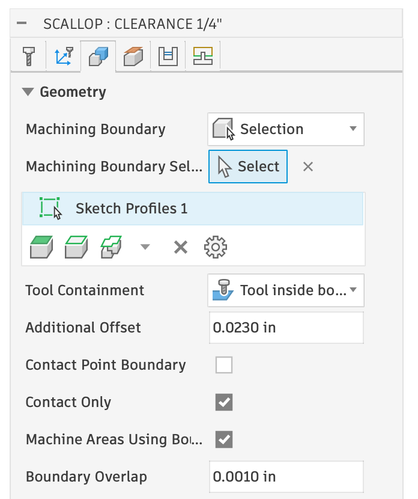    
  </Frame>

  <Frame caption="Additional Offset Expression">
  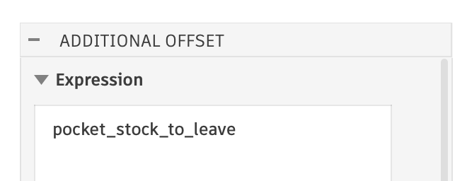    
  </Frame>
</Columns>

<Tip>
You can use any 3D toolpath you want to do the clearance, just make sure you set Boundary and Offset the same as the example.

An easy way to choose another clearance operation is by right clicking on the toolpath, Create Derived Operation -> 3D Milling -> and picking something else. Most the settings are transferred over, but ensure the Tool Containment is set to “inside”, as sometimes that gets reset. Morphed Spiral is a good alternative for 3D shapes.
</Tip>

### 3. Additional Clearance Toolpaths

Additional clearance toolpaths will be added for each additional smaller diameter bits you checked. The only difference in these toolpaths is they have **Rest Machining** turned on.

<Frame>
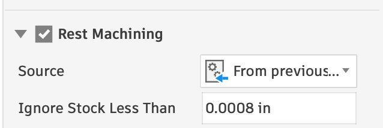  
</Frame>

### 4. Clearance Rest with VBit

This is another Scallop toolpath setup with the same VBit you initialy picked and it's purpose is to remove all the material that the previous clearance toolpaths could not get to.

It is also constrained by the same Design sketch and has Rest Machining turned on. What is different is the Tool Containment is set to **center** and the additional offset is `-pocket_stock_to_leave` (negative pocket stock to leave - which is the same math as before). Fusion treats negative values to be on the inside of a "center" tool containment.
<Frame>
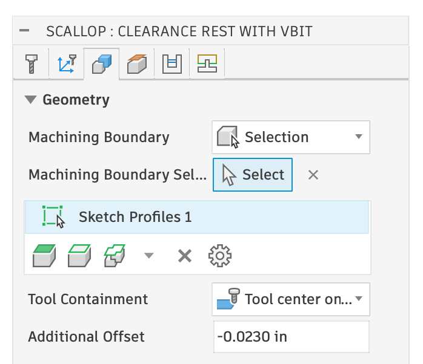  
</Frame>

<Pencil>
</Pencil>

## Toolpath Reordering

The default order would be: V-bit, Clearance Bit, V-bit. This causes an unnecessary tool change back to the V-bit at the end. However, moving the last "Clearance Rest with VBit" operation above the Clearance operation will cause it to re-calculate and not be correct (it’d try to remove everything the clearance should be doing). To solve this, you can right click on the V-bit Rest operation and check **Protect**. It will show **Protected** via a lock icon. You can then drag the protected toolpath above the Clearance operation.

<Note>
If you do this, and you change something that makes the toolpaths need recalculation, you will have to move it back and unprotect it.
</Note>

## VBit First or Clearance First

I prefer to do the v-bit portion first, and finish with the clearance bit. Some people prefer to do the Clearance operation first. If you want to do this, you can just drag the clearance operation(s) before the VBit Outline. If you do that, you won’t have to Protect the V-bit Rest.

<Footer />
