import Footer from "/shared/footer.mdx";

<Accordion title="1. Create a basic shape in Fusion">

<Steps>
  <Step title="File -> New Document">
  
  Select Hybrid Design
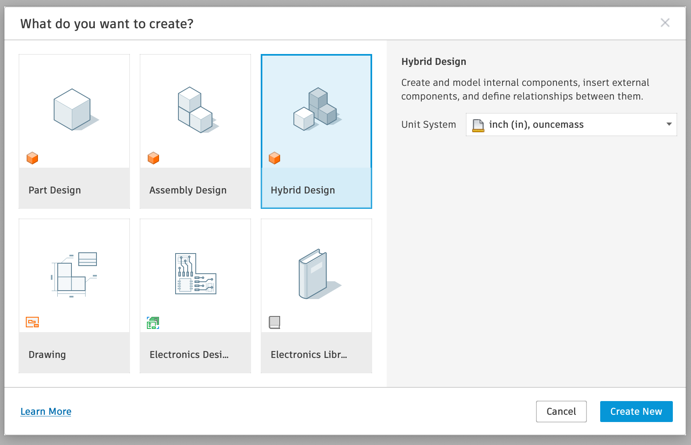  
</Step>

<Step title="Create a new sketch">

* A. Select the X/Y Plane
* B. Click **New Sketch**

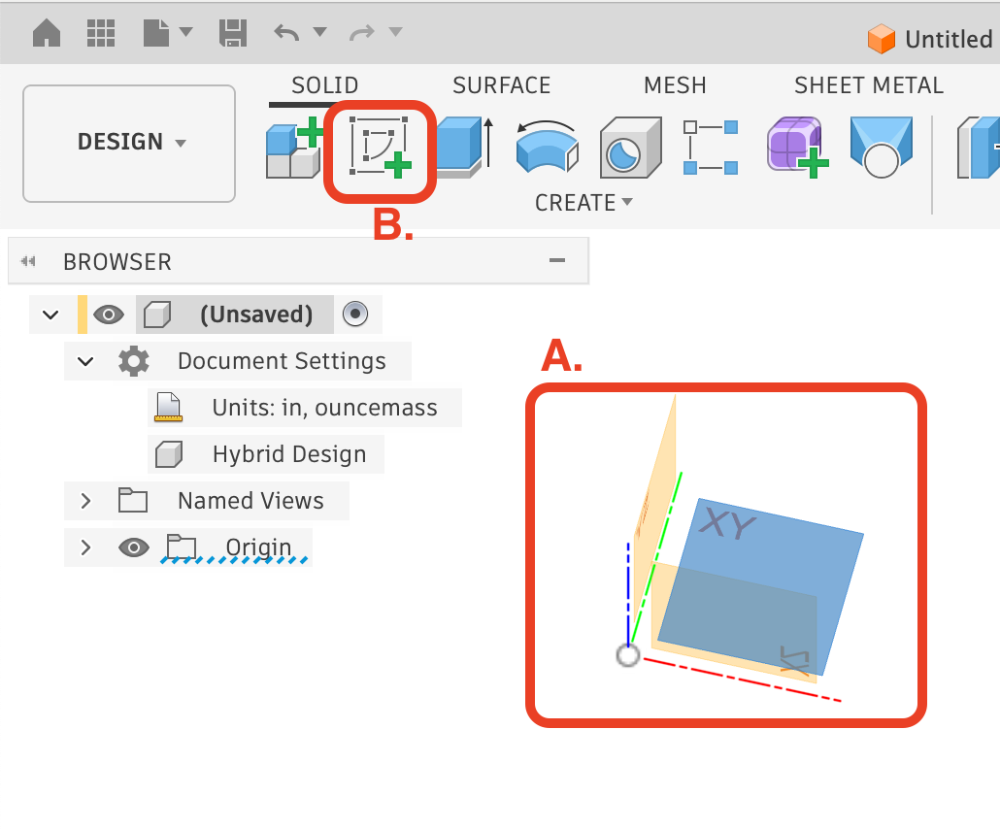  

</Step>

<Step title="Draw a basic rectangle">

* A. Click 2-point rectangle
* B. Click and drag to create a rectangle

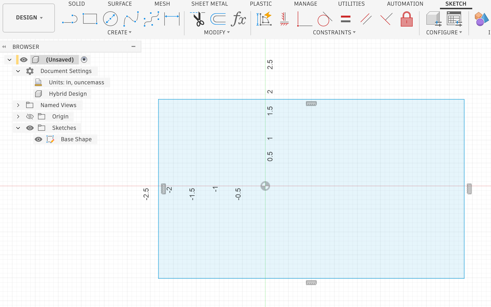  

</Step>

<Step title="Extrude the rectangle">

* A. Select the profile (blue)
* B. Type "E" for extrude
* C. Drag the Extrude arrow up, or type in a Distance
* D. Hit Enter

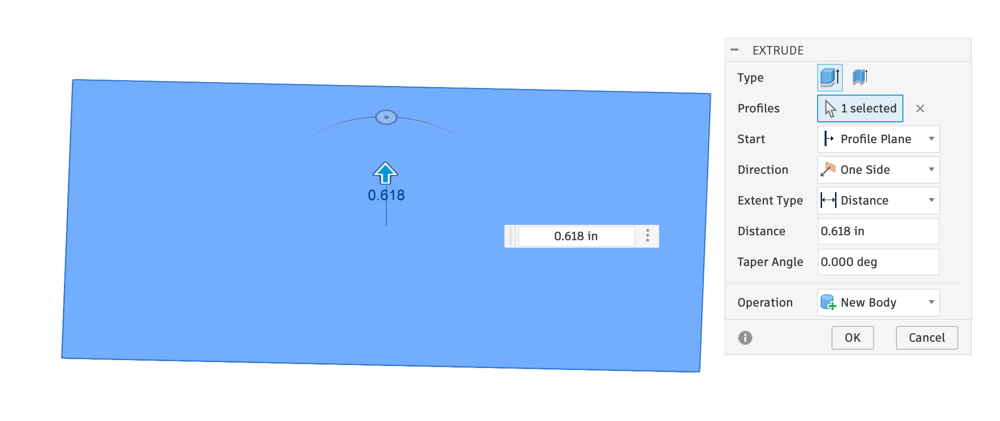  

</Step>

</Steps>
</Accordion>

<Accordion title="2. Create your Design Sketch above the shape">
<Steps>

<Step title="Select the top face">
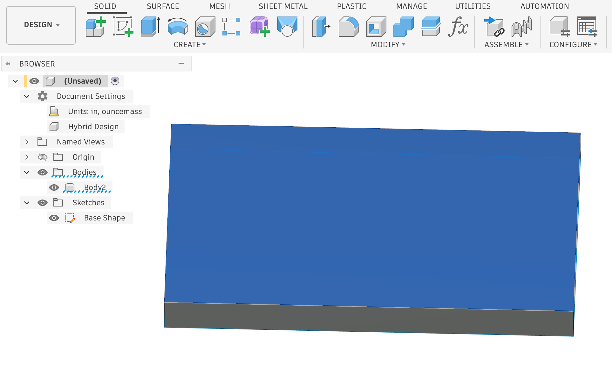  
</Step>

<Step title="Click Create Sketch">
</Step>

<Step title="Click Create -> Text">
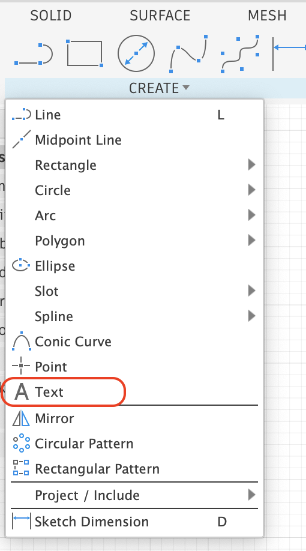  
</Step>

<Step title="Write some text above the shape">
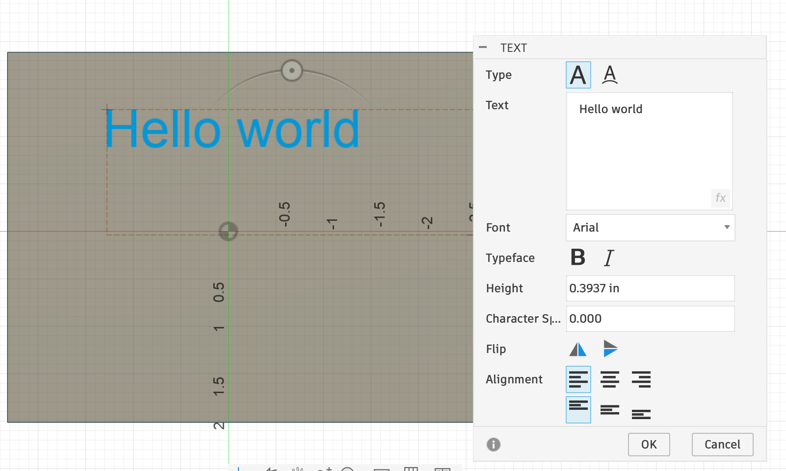  
</Step>

<Step title="Click Finish Sketch">
</Step>

</Steps>

</Accordion>

<Accordion title="Optional: Modify your design for your bits">
TODO: round corners documentation reference
</Accordion>

<Accordion title="Optional: Add your bits to the document">
See [Adding Document Bits](/adding_document_bits#add-more-bits)
</Accordion>

<Accordion title="3. Create the Inlays" defaultOpen>
<Steps>

<Step title="Create -> VBit Inlay / VCarve">
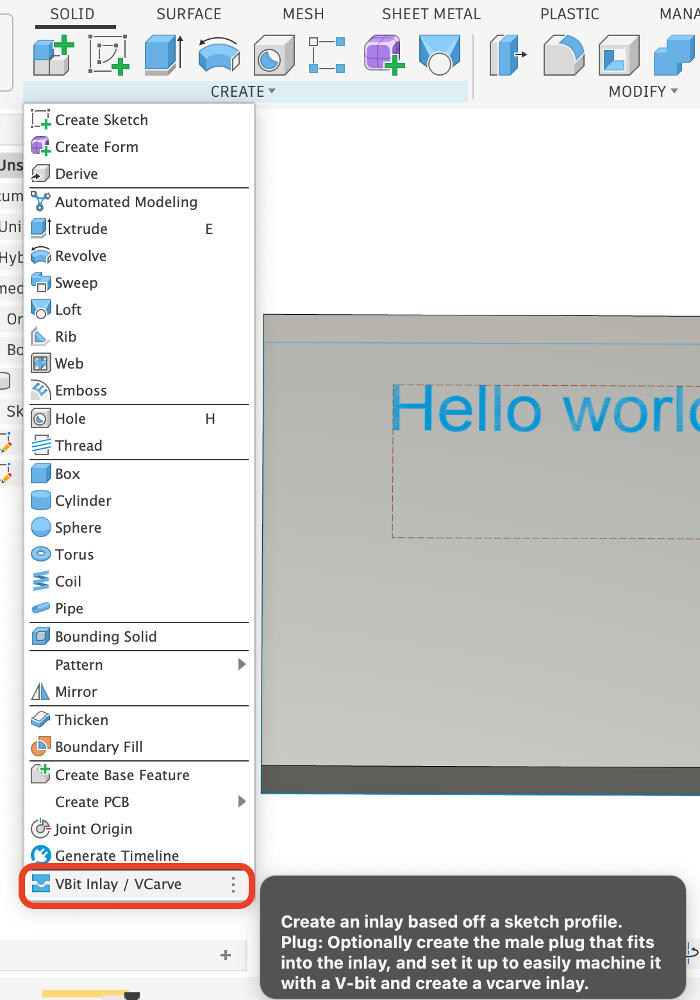  
</Step>

<Step title="Click the Select button next to **Profiles**">
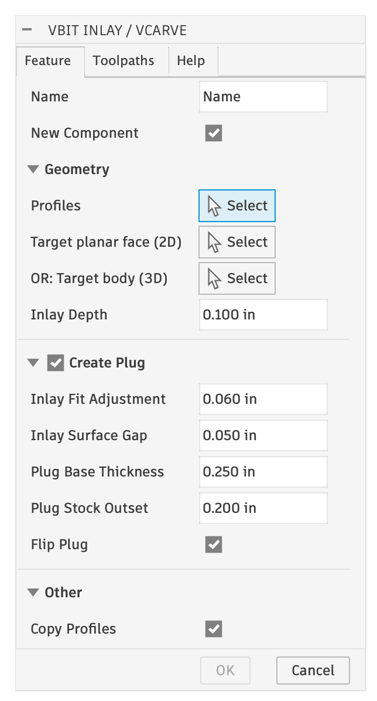  
</Step>

<Step title="Click the Sketch Text to select it">
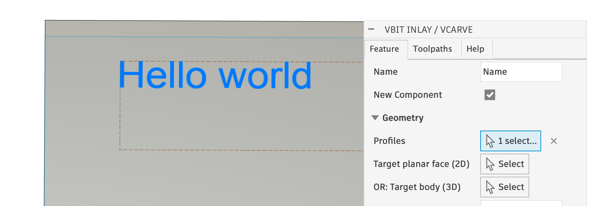  

<Note>
  You can also select the Sketch in the Browser
</Note>

</Step>

<Step title="Click the Select button next to **Target Planer Face (2D)**">
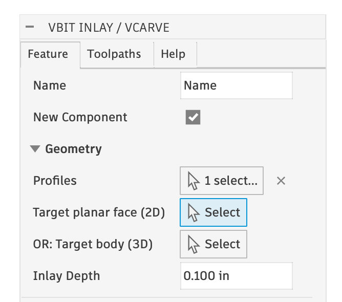  
</Step>

<Step title="Click the top face on the Body">
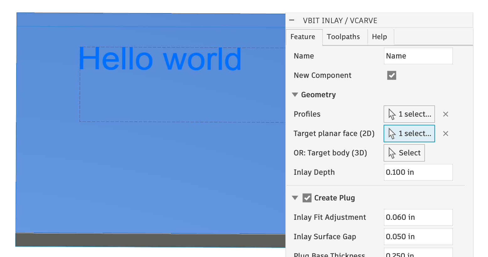  
</Step>

<Step title="Click OK">
 Four [Design Components](/design-components) are created:
 1. Name Pocket
 2. Name Inlay
 3. Name Plug
 4. Name Plug Stock
</Step>

</Steps>

</Accordion>

<Accordion title="4. Machine the Pocket">

<Steps>
  <Step title="Open the Manufacturing Workspace">
    
  </Step>  
  <Step title="Select the Setup">
    
  </Step>  
  <Step title="Verify the toolpaths">
    
  </Step>  
  <Step title="Run the Simulation">
    
  </Step>  
  <Step title="Post process / export GCode, and run it on your CNC">
    
  </Step>  

</Steps>

</Accordion>

<Footer />