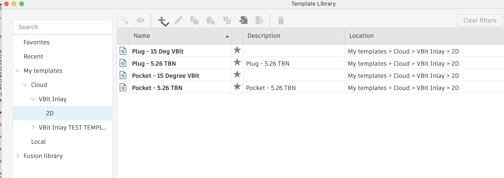

import Footer from "/shared/footer.mdx";

<Frame>
    
</Frame>

<Note>
    I'm still working on this documentation.
</Note> 

Right click on a group of toolpaths that work for you and save them as a template in "Cloud / VBit Inlay", optionally organizing them by 2D or 3D, and maybe even by Plug or Pocket.

Once you do this, all the templates under "VBit Inlay" will show up in the plugin.

When you choose a template, all the toolpaths will be copied over to the Setup, and the appropriate Sketches will be set to constrain were they machine.

<Footer />