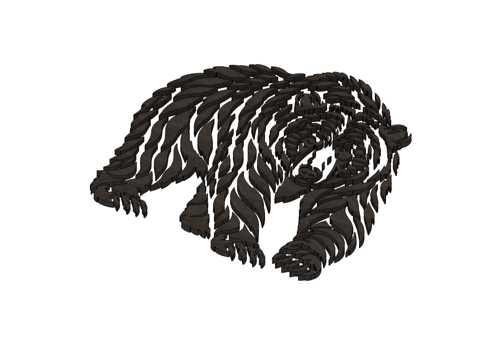
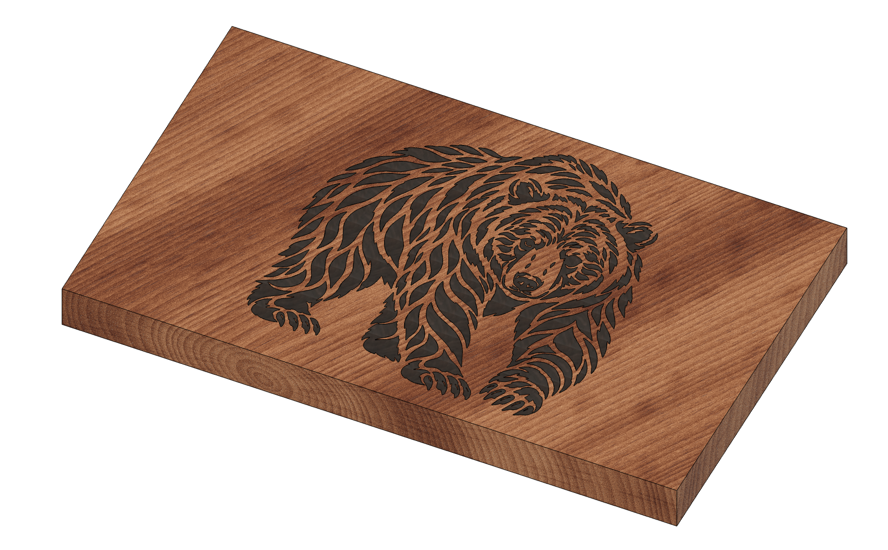
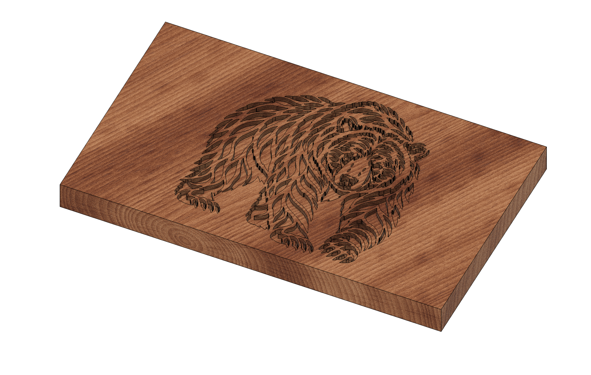
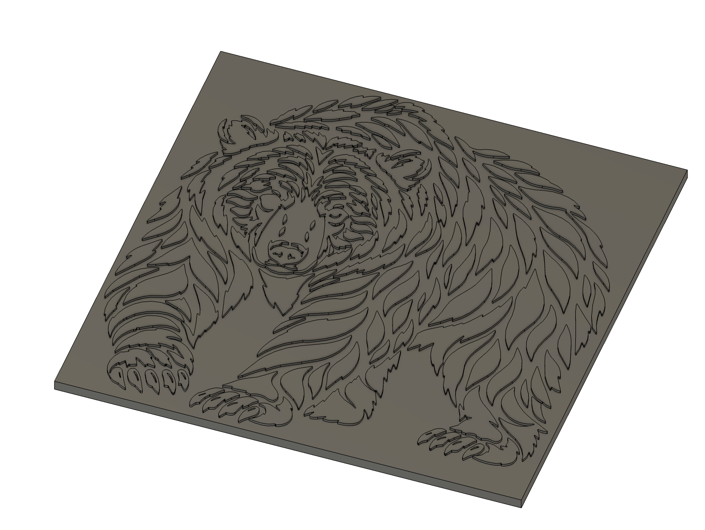
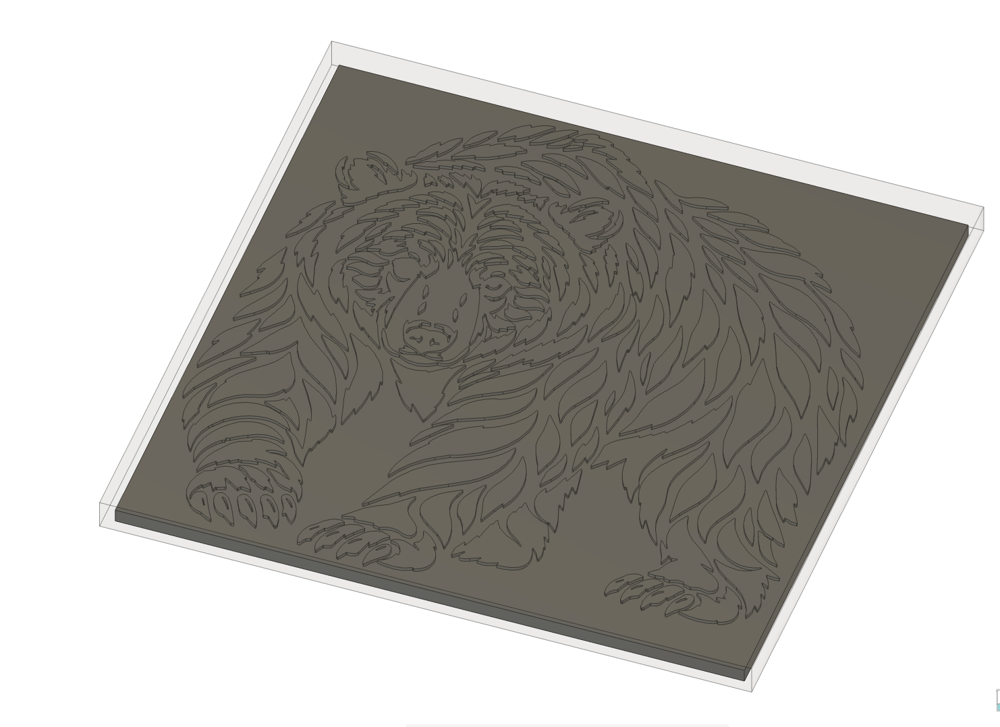
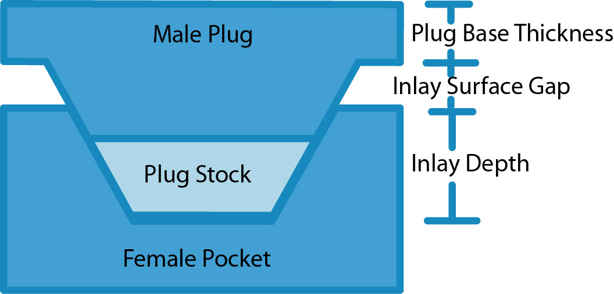
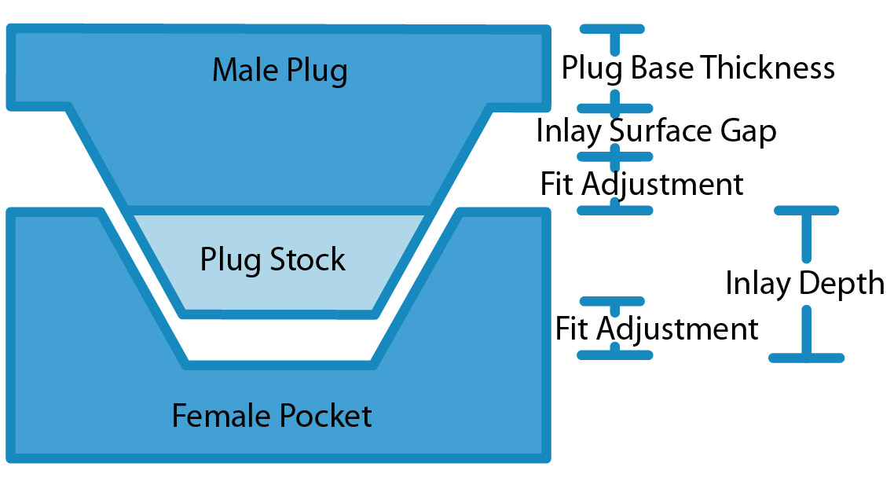

import Footer from "/shared/footer.mdx";

The following is generate terminology that will be used throughout the documentation. The plugin will also create **Components** with the part name as a postfix.

## Inlay

The part that fits into the pocket and is at the finished size. 

<Columns cols={2}>
  <Frame caption="Inlay">

  </Frame>
  <Frame caption="Inlay In a Pocket">

  </Frame>
</Columns>

The plugin will generate the inlay as part of the creation process. Generally, it is only used for looks, and not for machining CAM or toolpaths.

## Female Pocket

The part that the inlay goes into is called the **female pocket**, or just **pocket**. The pocket will be machined out with a v-bit, and the sides will have an angle based on the angle of the bit used. 

The design in Fusion will show the pocket with straight edges, but when machining or running a simulation the angle will appear.

## Male Plug & Plug Stock

The complete male plug that will fit into the inlay when you are constructing it. This includes a backing, the Base Plug Thickness, which will be cut off or machined off after the inlay has been glued in.

<Columns cols={2}>
  <Frame caption="Plug">

  </Frame>
  <Frame caption="Plug with Plug Stock">

  </Frame>
</Columns>

When looking at a plug, the top portion is what will fit into the inlay, and it is flipped, so the design appears mirrored. The top of the plug shown in Fusion is theoretical exact point at which it will enter the female pocket, with nothing actually fiting inside the depth of the inlay. The material that actually fits into the pocket is not shown in the plug component. Note that another component exists: the **Plug Stock**, which has an opacity of 40%, so you can easily see the Plug. The Plug Stock is the part that actually fits into the pocket; it sits higher on the plug (when looking at the plug from the top) by the inlay depth (minus some adjustments).

For 3D inlays, the plug stock and generated shape is essential and very important to getting a fit. 

## Side View

The Inlay Depth is how deep the inlay will go into the Female Pocket. The Male Plug will have a Plug Base Thickness to hold it all together, which you will remove after the inlay glue has dried. The Inlay Surface Gap is the space between the base and the top of the inlay. The Plug Stock is additional material not in the design, but in the stock that allows the inlay to seat correctly.

The **Fit Adjustment** is the only parameter you will modify to get the inlay to fit properly. There is no glue gap! Simply changing the Fit Adjustment will make the fit better, as described later. 

The Fit Adjustment only affects the plug. Note that changing the Fit Adjustment will adjust the gap below the plug, and the physical space above the inlay (the physical surface gap). You do not have to change the **Inlay Surface Gap** to get a better fit; pick some value and stick with it, unless you find you need more or less space for some other reason.  See [VBit Inlay Parameter List](/known_parameter_list) for some known values that work for me.

## 2D vs 3D Inlay

A 2D or Flat Inlay is a basic inlay on a flat surface. The toolpaths, and the model will be much simpler and faster to generate, and will attempt to use 2D Toolpaths, such as Engrave and 2D Pocket.

A 3D or Curved Inlay is a complex inlay on a non-planar surface, or across multiple surfaces. The inlay generation is much more complex, and the toolpaths require 3D toolpaths, and take a lot longer to generate.

<Footer />
