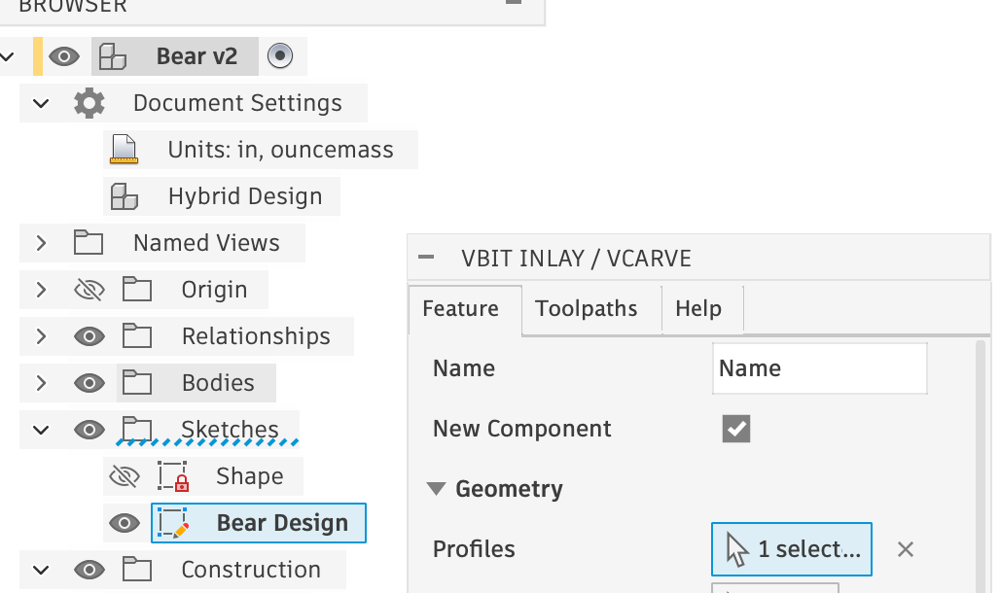

import Footer from "/shared/footer.mdx";

This is an overview of the Features tab for the **VBit Inlay / VCarve** command.

    

## Name
The name of your inlay - generated component names are based on this name.

## New Component
The plugin **will always** create new Components for: the Inlay, the Plug, and the Plug Stock. It will optionally create a new component for the target body if New Component is checked. If it is not checked, the target body will be directly modified. See [Organization Recommendations](/organization_recs) for more details.

## Profiles
 The closed profile shapes for the inlay. You can select entire Sketches, Profiles and Text objects.  
 
 <Columns cols={2}>
  <Frame caption="Profiles Selected (Dark Blue)">

  </Frame>
  <Frame caption="Sketch Selected (From the Browser)">

  </Frame>
</Columns>

 If an entire sketch is selected, the algorithm will attempt to select every-other closed profile for the inlay, as that is generally what people want.

 Individually selecting Profiles or Text objects must all be from the same Sketch.

The sketch  MUST be “on or above” your Target face or body, and should all be co-planar. The inlay is created by projecting “down” to the shape (ie: the perpendicular normal from the Sketch’s X/Y plane). 

To create a sketch “above” a design, right click on the X/Y Plane and select Offset Plane. Offset the plane until it is above your main 3D body, and then create a sketch at this location. Note that the profile and Sketch do NOT have to be in the X/Y plane, and can be on any face or in any orientation. 

## Target planar face (2D)

Selecting a planar face will generate a 2D / flat inlay, and toolpaths better suited for 2D shapes by using 2D toolpaths (Engrave / 2D Pocket / Face). You can select more than one target planar face: select one first, and then multi-select all others and the algorithm will limit selection to faces that are planar. Multi-selecting all at once may select non-planar faces.

## Target body (3D)

 Selecting an entire body will generate a 3D inlay, and 3D toolpaths for complex shapes. Currently only one body can be selected at a time.

## Inlay Depth
 How deep the inlay should be. I’d recommend 0.100" for superficial inlays — although, that is the depth I use for my kitchen utensils, and they get regularly used and washed, and I haven’t ever had an issue with the inlay over the past several years. Use 0.230" to 0.250" (around 6mm) for a deep inlay that needs more strength: something like a cutting board. The Inlay Depth is a constant; you do not need to change it to affect how well the plug fits into it. This value can later be customized after the inlay is created via the `inlay_depth` User Parameter. See [Parameters](/parameters) for more information.

## Create Plug
Optionally create a Male Plug, and the associated Male Plug Stock that will fit into the inlay pocket. Uncheck this if you only want to do a VCarve of the design.

## Inlay Fit Adjustment

This is the “glue gap” underneath the plug when in the inlay. You will need to set this to the value that works best for your particular bit and machine that you are using. See Finding the Inlay Fit Adjustment for more information. You can later change this by changing the `inlay_fit_adjustment` parameter.

## Inlay Surface Gap
 The gap that will be above the inlay before the Plug Base Thickness. Keep it small to avoid having to do a deep inlay. I find 0.050" works well. This value is a constant; once you pick a surface gap you don’t need to change it to adjust the fit, unless you find you need more or less clearance for some other reason. This value can later be customized after the inlay is created via the `inlay_surface_gap` User Parameter. See [Parameters](/parameters) for more information.

## Plug Base Thickness
 How thick the backing of the plug will be to hold it together. You probably want at least 0.25″.

## Plug Boundary Offset
This will be the increased sides size the plug around the main plug part itself. This is useful to set it to be at least your clearance bit's diameter, so the bit can reach all the way around the plug. It is also useful if you want to have some offset around your shape. By default it is rectangular, but in the future it may be more organic.

## Plug Stock Offset
 The plug stock will be a rectangular stock size that fits around the plug. It will be offsset from the plug by this amount. Have it be large enough of a value for you to clamp the plug down (ie: 0.200″ to 0.300″) from the top, or have it be 0 if you want to hold your plug down with some other manner (ie: tape/vacuum/etc). You can later change this by editing the generated sketch for the plug stock. Sometimes, you want to make the offset large enough to clamp down, and also perform a cutout of the plug with tabs.

## Flip Plug
 The plug is created right above the female pocket. If Flip Plug is checked, the plugin will flip the plug “upright”. It will also do a “Capture Position” in the Timeline. If the plug is not flipped, the generated Setup for the plug will be upside down, and require some correction by the user to flip the z-axis orientation.

## Copy Profiles
 When checked, the plugin will do a copy of the selected profiles to the target sketches. Otherwise, it will “Project” the inlay component into the other components to limit machining areas, but this will frequently give degenerate segment errors. 
 
 <Tip>Prefer to use “Copy Profiles” for designs that you import into Fusion, but if you are drawing sketches inside of Fusion with bezier curves you may need to uncheck this feature.</Tip>

<Footer />