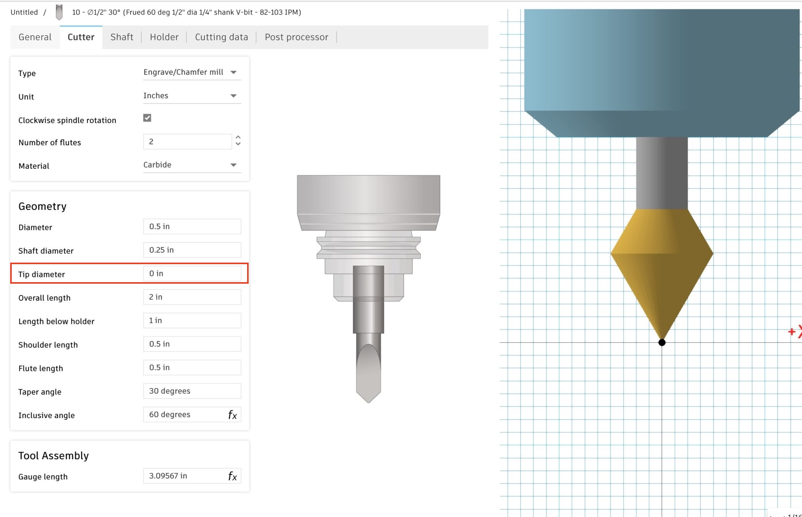

import Footer from "/shared/footer.mdx";

### Acceptable Bit Types

Bits that work with VCarving are **Engrave/Chamfer mills** and **Tapered Mills**. **Tapered Mills** (ie: a Tapered Ball Nose / TBN) will only work with the Pencil operation (3D Toolpaths) and will not work with the Engrave toolpath for 2D flat inlays. However, there is an easy work around to use a tapered ball nose (TBN) with Engrave, noted below.

It is imperative that you setup your bit properly in Autodesk Fusion! The "Inlay Fit" will not work well if your bit is not set correctly, and your `inlay_fit_tolerance` will be very off.

<Warning>
    Some people have their v-bits as a Spot Drill - this will not work. You will have to re-create the bit as a Engrave/Chamfer Mill.
</Warning>

### Bit Angle

Bits are usually (but not always) named and sold by the **Inclusive Angle**, which is the total angle. The **Taper Angle** is half the inclusive angle, as shown to the right. Fusion will name bits based on the Taper Angle — so if you see it named as a 30 degree bit in Fusion, don’t get confused and put 30 degrees as the Parameter when it is really 60; things won’t work right!

<Warning>
    The **Inlay Bit Angle** (Parameter: `inlay_bit_angle`) used by VBit Inlay is the **Inclusive Angle** (ie: the total angle).
</Warning>

<Frame caption="This is a 60 degree bit with an 0.020 in tip diameter. The total angle is 60 degrees; the taper angle is 30 degrees, and Fusion will show the name as a 30 degree bit. In VBit Inlay the **Inlay Bit Angle** should be put as **60 degrees**">  
      
</Frame>

Some bits, such as Tapered Ball Mills, such as Freud 72-400 5.4° x 1/16″ Tapered Ball Tip, are listed and sold by the **taper angle**! You will need to input the inclusive angle into VBit Inlay: 5.4°x2=10.8°. Just be aware of this, as it is important if you manually input the bit angle.

### Pure V-Bits (No Tip Diameter)

<Danger>
Set a tip diameter on all bits - even pure V-Bits!
</Danger>

Pure V-bits, like shown below, will not work with the Pencil or 2D Pocket Toolpath. **Toolpath generation will spin forever, or will fail**, unless you set a Tip Diameter. You can use a really small Tip Diameter, like 0.001", to get it to work, and it shouldn’t affect the inlay. If you are using metric, type in exactly 0.001" and hit enter, and it will convert it to 0.0254mm. If you put too small a value, it will never finish computing (ie: 0.0001" will take forever), and too large a value will have innaccuracies.

<Frame caption="This bit has a 0 tip diameter, and some toolpath generations will fail with it! Simply set a small diameter, such as 0.001 in.">  
      
</Frame>

### Tapered Ball Nose (TBN) for Engraving

TBN bits work fine with 3D toolpaths, but Fusion will allow them for a 2D “Engrave” Toolpath for flat inlays. 

**Workaround:** You can copy your TBN tool and set the type to be an **Engrave/Chamfer mill** and set the tip diameter to be the ball diameter. Then it will work as for Engrave / 2D Toolpaths, but note that it will act like it has a flat bottom instead of a ball. For a steep TBN, this won’t cause much discrepancy with what it cuts: 5.26 tapered ball nose bits will have about a 0.001" cut difference.

<AccordionGroup>
    <Accordion title="Example: SPE W01005 Tapered Ball Nose Setup as an Engrave Bit">
    
  </Accordion>
</AccordionGroup>

<Danger>
    Don't get the **diameter** confused with the **radius**! Most bits have the ball radius advertised; you must put in the diameter, which is 2xradius. An incorrect value will have your fit adjustment be way off.
</Danger>

### Bit Recommendations

For fine detailed inlays, and use a 15 degree v-bit: [Amana 15-degree v-bit](https://amzn.to/4oeJ1Zo) or similar. This bit has a 15 degree inclusive angle and a small 0.005" tip diameter. Disadvantage: I've accidentally broken the tip of this fine bit one time. 

The [SPE W01005 5.26 Deg Tapered Ball Nose](https://amzn.to/4aNb1zP) is affordable and cuts really well. TBN bits are generally stronger than a v-bit, and less likely to break, especially . They also tend to be a spiral upcut bit, which clears chips better. Disadvantage: you have to round over all the corners in your design by at least the radius of the bit.

### Changing a Toolpath's Tool / Bit

<Danger>
Be careful if you manually select a different VBit tool in your Toolpaths!
</Danger>

If you change the tool, be sure to keep the `inlay_bit_angle` [Parameter](/parameters) in sync. You must go to "Change Parameters" in the design space and udpate it, if you pick a bit with a different angle! This is all automatic if you selected the bit when the plugin runs.    

<Note>
You must also use the same VBit for the pocket and the plug.
</Note>

<Footer />