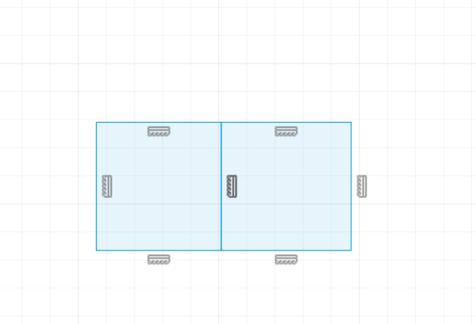
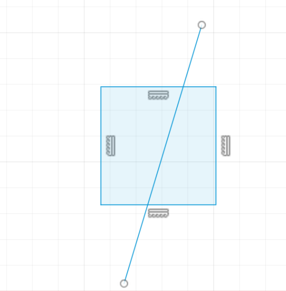

import Footer from "/shared/footer.mdx";

The inlay shape will be driven by a vector design drawn in a Sketch. The Sketch must be on or above the target body that you want to put the inlay in. The closed profiles are what will be used for the inlay creation; you can either individually select each closed profile you want to use, or select the entire sketch, and the plugin algorithm will attempt to choose the appropriate closed profiles. Learn the basics of Sketches: [Autodesk Fusion 360 Basics: Getting Started with Sketching](https://www.autodesk.com/products/fusion-360/blog/autodesk-fusion-360-basics-sketching/)

Vector designs must be clean. It is very important to have no overlapping vectors, as that will create ambiguity. 

For example, these two squares on the left share an overlapping edge, and the line/square on the right has a line vector overlapping the square.

<Columns cols={2}>
  <Frame caption="Bad vectors: overlapping edge or a shared edge">

  </Frame>
  <Frame caption="Bad vectors: overlapping line">

  </Frame>
</Columns>

The overall design can also affect your inlay fit, and in general you have to modify the design based on the particular v-bit you intend to use.

Vector designs should also generally be "machinable" with the bit you are using. Most bits have some sort of tip diameter (or radius), even if it isn't advertised. You should round all corners in your design to have at a mimimum the same radius as your tip radius. This is especially important when using a Tapered Ball Nose. 

TODO: see bits for more information.

Watch this video on how to create proper designs: [How to Design Correctly for VCarve Inlays](https://www.youtube.com/watch?v=TWe6k2S9LmE)

<Footer />
